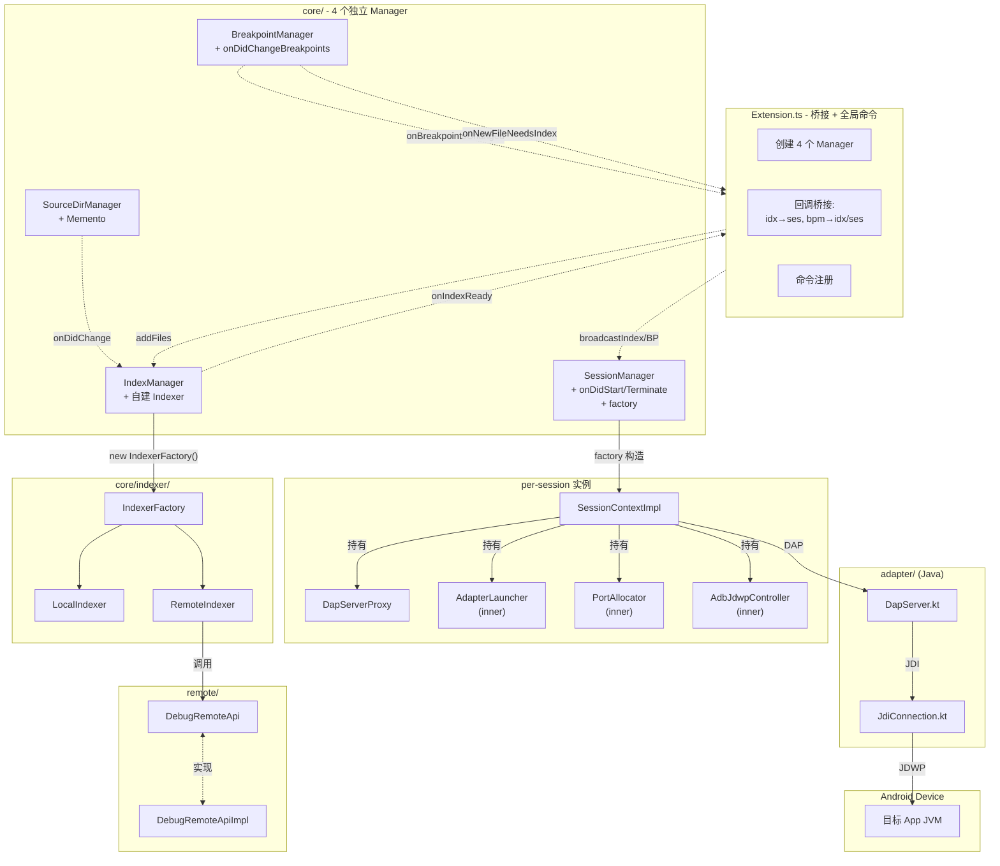
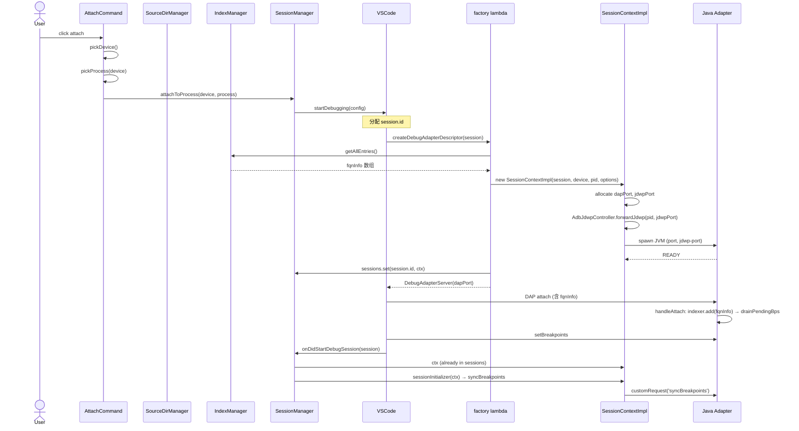
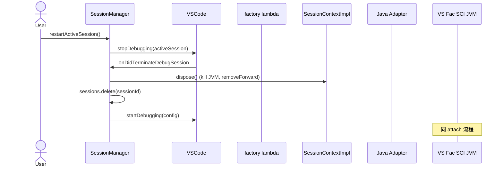
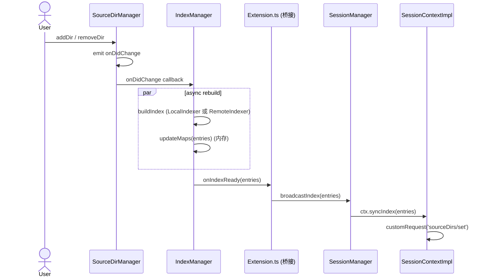
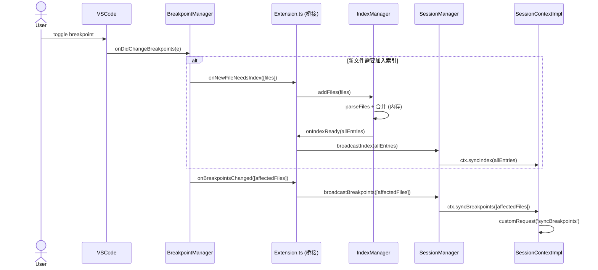

# Android Debugger 多会话架构设计

> 本文档记录重构后的多会话调试架构设计。
> MVP 已跑通，本设计将单例全局状态拆解为多 Manager 协作架构，支持多会话并发调试。

---

## 一、核心设计决策

### 1.1 关键洞察：资源创建点下沉到 `createDebugAdapterDescriptor`

```mermaid
flowchart LR
    A["attach 按钮点击"] --> B["UI 交互阶段<br/>pickDevice + pickProcess"]
    B --> C["build session config<br/>(__device + __pid + fqnInfo)"]
    C --> D["startDebugging(config)"]
    D --> E["VSCode 分配 session.id"]
    E --> F["createDebugAdapterDescriptor(session)"]
    F --> G["new SessionContextImpl(session)<br/>分配 dapPort / jdwpPort<br/>forwardJdwp + spawn JVM"]
    G --> H["sessions.set(session.id, ctx)"]
    H --> I["返回 DebugAdapterServer(dapPort)"]
    I --> J["VSCode 连接 JVM"]
    J --> K["onDidStartDebugSession fires<br/>sessionInitializer 兜底"]
```



关键点：

1. **SessionContextImpl 在 `createDebugAdapterDescriptor` 内部构造**。此时 `session.id` 已存在，可直接作为 `sessions: Map<sessionId, SessionContextImpl>` 的 key，**无需 attachId / sessionToken**。
2. **端口分配、JVM 启动、JDWP forward 全部在 SessionContextImpl 构造时完成**。factory 本身无状态，只读 config 返回 `DebugAdapterServer(dapPort)`。
3. **SessionContextImpl 拥有自己的所有资源**（proc / jdwpController / dapPort / jdwpPort）。其他模块不持有它的引用，只能通过 SessionManager 的 sessions Map 查询。

### 1.2 索引传递模型：纯内存 + DAP attach arguments

```mermaid
flowchart LR
    SD["SourceDirManager"] -->|"onDidChange"| IM["IndexManager<br/>(entries: Map)"]
    IM -->|"onIndexReady"| Ext["Extension.ts"]
    Ext -->|"broadcastIndex"| SM["SessionManager"]
    SM -->|"syncIndex"| SCI["SessionContextImpl"]
    SM -->|"factory lambda<br/>getAllEntries"| Factory["factory"]
    Factory -->|"startDebugging<br/>(config.fqnInfo)"| VS["VSCode"]
    VS -->|"DAP attach<br/>arguments.fqnInfo"| SCI
    SCI -->|"spawn JVM"| JVM["Java Adapter"]
    JVM -->|"handleAttach<br/>indexer.add(fqnInfo)<br/>→ drainPendingBps"| Idx["SourceIndex"]
```



关键点：

- **`IndexManager` 完全在内存**。`Map<string, SourceEntry>` + `Map<string, string[]>`，生命周期 = 插件生命周期。
- **索引通过 DAP `attach` 请求的 `arguments.fqnInfo` 字段传递**，**不落盘**。`SessionContextImpl` 构造时，SessionManager factory lambda 从 `IndexManager.getAllEntries()` 拿到当前快照，写进 session config 的 `fqnInfo` 字段。
- **adapter 在 `handleAttach` 里加载索引**，时序上严格在 `drainPendingBps()` 之前，保证 VSCode 自动发的早期 `setBreakpoints`（被 `pendingJdiBps` 暂存）重放时索引已就位。
- 源目录变化 → `IndexManager` 内存重建 → emit `onIndexReady` → Extension 桥接 → `SessionManager.broadcastIndex` → 所有活跃会话的 `syncIndex`（走 `sourceDirs/set` 自定义请求，**不是**重启）。
- 跨 VSCode 实例零冲突（entries 走 DAP attach 内存，不写共享文件）。

### 1.3 设计原则（决策汇总）

| # | 原则 | 具体表现 |
|---|------|---------|
| 1 | **Manager 独立自治** | `SourceDirManager` / `IndexManager` / `BreakpointManager` / `SessionManager` 互不知道彼此实例，通过回调通信 |
| 2 | **自己的活自己干** | `IndexManager` 自己创建 Indexer、自己监听源目录；`BreakpointManager` 自己注册 `onDidChangeBreakpoints`；`SessionManager` 自己注册 `onDidStart/Terminate` 和 factory |
| 3 | **VSCode 回调归各 Manager** | 见 §1.4 |
| 4 | **跨 Manager 信息查询通过 Callback** | `SessionManager` 需要 `device/process` 通过 `session.configuration.__device/__pid`；需要 `javaPath/jarPath` 通过构造注入的 deps；需要初始化钩子通过 `setSessionInitializer` |
| 5 | **Extension.ts 只做桥接 + 全局命令** | 不持有任何 Manager 实例的状态；不注册领域内 VSCode 回调 |
| 6 | **所有 Manager 接受 `ExtensionContext`** | 按需取 `workspaceState` / `globalState` / `extension.id` 等 |
| 7 | **资源 per-session 化** | SessionContextImpl 是 JVM / JDWP forward / dapPort / jdwpPort 的唯一所有者 |
| 8 | **factory 是 SessionManager 内的匿名 lambda** | 消除 `AndroidJavaFactory` 类 |

### 1.4 VSCode 回调归属

| 回调 | 归属 | 说明 |
|------|------|------|
| `vscode.debug.onDidStartDebugSession` | SessionManager | 创建会话并初始化 |
| `vscode.debug.onDidTerminateDebugSession` | SessionManager | 销毁会话 |
| `vscode.debug.registerDebugAdapterDescriptorFactory` | SessionManager | factory lambda 内部 new SessionContextImpl |
| `vscode.debug.onDidChangeBreakpoints` | BreakpointManager | 监听断点变化、auto-include 检测 |
| `vscode.workspace.onDidChangeWorkspaceFolders` 等 | 各 Manager | 谁关心谁注册 |
| `vscode.commands.registerCommand` | Extension.ts | 全局命令，没人认领 |

---

## 二、完整架构图



---

## 三、目录结构

```
src/
├── core/
│   ├── SourceDirManager.ts         # 源目录 + Memento
│   ├── BreakpointManager.ts         # 断点事件 + onDidChangeBreakpoints
│   ├── IndexManager.ts              # 索引管理 + 自建 Indexer + 纯内存 entries
│   ├── indexer/
│   │   ├── Indexer.ts               # 接口 (Indexer, IndexOptions, FqnEntry, SourceEntry)
│   │   ├── IndexerFactory.ts        # 工厂
│   │   ├── LocalIndexer.ts          # 本地实现
│   │   └── RemoteIndexer.ts         # UI 侧远程实现 (调 DebugRemoteApi)
│   ├── SessionManager.ts            # 会话管理 + onDidStart/Terminate + factory
│   └── session/
│       ├── SessionContext.ts        # 会话上下文接口
│       ├── SessionContextImpl.ts    # 会话上下文实现 (含 inner classes)
│       └── DapServerProxy.ts        # DAP customRequest 封装
│
├── remote/
│   ├── DebugRemoteApi.ts            # Workspace API 接口
│   └── DebugRemoteApiImpl.ts        # Workspace 实现 (export buildIndex)
│
├── ui/
│   ├── StatusBar.ts
│   ├── TreeView.ts
│   ├── Decoration.ts
│   └── ProcessPicker.ts
│
├── commands/
│   ├── AttachCommand.ts             # 纯 UI: pickDevice + pickProcess + 调 sessionManager.attachToProcess
│   └── MarkSourceDirCommand.ts      # mark / unmark
│
└── Extension.ts                     # 桥接 + 全局命令
```

---

## 四、组件职责

| 组件 | 位置 | 类型 | 职责 |
|------|------|------|------|
| SourceDirManager | core/ | 独立 | 管理源目录 + 持有 StatusBar/Decoration/TreeView |
| IndexManager | core/ | 独立 | 自建 Indexer + 监听源目录 + 纯内存 entries |
| BreakpointManager | core/ | 独立 | 注册 onDidChangeBreakpoints + 解析 + 回调 |
| SessionManager | core/ | 独立 | 注册 onDidStart/Terminate + factory + 重启 + 广播 |
| Indexer | core/indexer/ | 接口 | 索引策略 |
| IndexerFactory | core/indexer/ | 工厂 | 创建 Local / Remote Indexer |
| LocalIndexer | core/indexer/ | 实现 | 本地索引 |
| RemoteIndexer | core/indexer/ | 实现 | 调 `DebugRemoteApi.buildIndex` |
| SessionContext | core/session/ | 接口 | 会话上下文契约 |
| SessionContextImpl | core/session/ | per-session | 资源所有者 + DAP 代理 + 持有 session |
| DapServerProxy | core/session/ | per-session | DAP customRequest 封装 |
| AdapterLauncher | core/session/ | inner | spawn JVM (SessionContextImpl 私有) |
| PortAllocator | core/session/ | inner | 分配 dapPort / jdwpPort (SessionContextImpl 私有) |
| AdbJdwpController | core/session/ | inner | adb forward / removeForward (SessionContextImpl 私有) |
| DebugRemoteApi | remote/ | 接口 | Workspace 侧 API |
| DebugRemoteApiImpl | remote/ | 实现 | Workspace 侧 buildIndex 实现 |
| Extension.ts | 根目录 | 编排 | 桥接 + 全局命令 |

---

## 五、接口设计

### 5.0 AdbRunner 接口变化（多设备支持）

```typescript
// src/adb/runner.ts
export interface AdbRunner {
  /**
   * 执行 adb 命令。args 已包含 adb 子命令及参数，runner 不自动加 `adb` 前缀。
   * 如果传 `serial`，runner 会自动在 args 前面插入 `-s <serial>`，
   * 让命令指向特定设备。`listDevices` 这种全局命令不传 serial。
   */
  exec(args: string[], serial?: string): Promise<AdbResult>;

  /**
   * spawn adb 长进程（如 `adb jdwp`）。同样支持 serial。
   */
  start(args: string[], serial?: string): ChildProcess;
}
```

变化点：

| 旧版 | 新版 |
|------|------|
| `runner.exec(['forward', ...])` | `runner.exec(['forward', ...], deviceSerial)` |
| `runner.exec(['devices'])` | `runner.exec(['devices'])`（不变） |
| 设备匹配在 adb 命令里隐式 | runner 自动注入 `-s <serial>` 前缀，调用方不用关心 |

这样 `AdbJdwpController` 构造时只需要 `new AdbJdwpController(runner, deviceSerial)`，调用 `forward`/`removeForward` 时只需要 `runner.exec(['forward', ...], this.deviceSerial)`，**runner 内部自动加 `-s <serial>`**。所有 adb 调用天然指向目标设备，调用方不用关心 `-s` 拼装细节。

### 5.1 DebugRemoteApi（remote/）

```typescript
// src/remote/DebugRemoteApi.ts
export interface IndexOptions {
  maxFiles: number;
  onProgress?: (current: number, total: number) => void;
}

export interface FqnEntry {
  fqn: string;
  file: string;
}

export interface DebugRemoteApi {
  buildIndex(dirs: string[], options: IndexOptions): Promise<FqnEntry[]>;
}
```

### 5.2 Indexer（core/indexer/）

```typescript
// src/core/indexer/Indexer.ts
export interface Indexer {
  buildIndex(dirs: string[], options: IndexOptions): Promise<FqnEntry[]>;
  dispose(): void;
}

export interface SourceEntry {
  fqn: string;
  path: string;
}
```

```typescript
// src/core/indexer/IndexerFactory.ts
import { LocalIndexer } from './LocalIndexer';
import { RemoteIndexer } from './RemoteIndexer';

export class IndexerFactory {
  constructor(private uiExtId: string) {}

  createIndexer(): Indexer {
    if (vscode.env.remoteName) {
      return new RemoteIndexer(this.uiExtId);
    }
    return new LocalIndexer();
  }
}
```

```typescript
// src/core/indexer/LocalIndexer.ts
export class LocalIndexer implements Indexer {
  async buildIndex(dirs: string[], options: IndexOptions): Promise<FqnEntry[]> {
    // UI 侧扫描 + parse
  }
  dispose(): void {}
}
```

```typescript
// src/core/indexer/RemoteIndexer.ts
import { DebugRemoteApi } from '../../remote/DebugRemoteApi';

export class RemoteIndexer implements Indexer {
  constructor(private uiExtId: string) {}

  async buildIndex(dirs: string[], options: IndexOptions): Promise<FqnEntry[]> {
    const ext = vscode.extensions.getExtension<DebugRemoteApi>(this.uiExtId);
    if (!ext?.exports?.buildIndex) {
      throw new Error('Remote indexer not available');
    }
    return await ext.exports.buildIndex(dirs, options);
  }
  dispose(): void {}
}
```

### 5.3 IndexManager（核心）

**纯内存实现**，不再维护任何持久化文件。索引条目通过 DAP attach 请求的 `fqnInfo` 字段传给 JVM（见 §1.2）。

```typescript
// src/core/IndexManager.ts
import { Indexer } from './indexer/Indexer';
import { IndexerFactory } from './indexer/IndexerFactory';

export type IndexReadyCallback = (entries: FqnEntry[]) => void;

export class IndexManager {
  private fqnByFile = new Map<string, string[]>();
  private fqnIndex = new Map<string, SourceEntry>();
  private indexer: Indexer;
  private onIndexReadyCallbacks: IndexReadyCallback[] = [];

  constructor(
    context: vscode.ExtensionContext,
    private sourceDirsManager: SourceDirManager
  ) {
    this.indexer = new IndexerFactory(context.extension.id).createIndexer();

    sourceDirsManager.onDidChange((dirs) => {
      this.rebuild(dirs).catch(err => Logger.error('[IndexMgr] rebuild failed', err));
    });

    // 启动时异步构建，不阻塞 activate
    sourceDirsManager.getAllDirs().then(dirs => {
      this.rebuild(dirs).catch(err => Logger.error('[IndexMgr] initial rebuild failed', err));
    });
  }

  /** 重建索引（仅内存） */
  private async rebuild(dirs: string[]): Promise<void> {
    const entries = await this.indexer.buildIndex(dirs, {
      maxFiles: getConfig().indexMaxFiles,
    });
    this.updateMaps(entries);
    this.onIndexReadyCallbacks.forEach(cb => cb(entries));
  }

  /** 增量添加文件（来自 BreakpointManager 回调触发的 auto-include） */
  async addFiles(files: string[]): Promise<void> {
    const newEntries = await this.indexer.parseFiles(files);
    for (const e of newEntries) {
      this.fqnIndex.set(e.fqn, { fqn: e.fqn, path: e.file });
      this.fqnByFile.getOrCreate(e.file, () => []).push(e.fqn);
    }
    const all = this.getAllEntries();
    this.onIndexReadyCallbacks.forEach(cb => cb(all));
  }

  private updateMaps(entries: FqnEntry[]): void {
    this.fqnByFile.clear();
    this.fqnIndex.clear();
    for (const entry of entries) {
      this.fqnIndex.set(entry.fqn, { fqn: entry.fqn, path: entry.file });
      this.fqnByFile.getOrCreate(entry.file, () => []).push(entry.fqn);
    }
  }

  // ========== 查询 ==========

  /** 给 SessionManager factory lambda 用：拿到当前 entries 快照，写进 DAP attach arguments */
  getAllEntries(): FqnEntry[] {
    return Array.from(this.fqnIndex.values());
  }

  resolveFqnsByFile(filePath: string): string[] {
    return this.fqnByFile.get(filePath) ?? [];
  }

  resolveByFqn(fqn: string): SourceEntry | undefined {
    return this.fqnIndex.get(fqn);
  }

  // ========== 回调 ==========

  onIndexReady(callback: IndexReadyCallback): void {
    this.onIndexReadyCallbacks.push(callback);
  }

  dispose(): void {
    this.indexer.dispose();
  }
}
```

### 5.4 BreakpointManager

```typescript
// src/core/BreakpointManager.ts
export interface BreakpointEntry {
  line: number;
  condition?: string;
  logMessage?: string;
  enabled: boolean;
}

export interface BreakpointFile {
  source: { path: string };
  breakpoints: BreakpointEntry[];
}

export type BreakpointsChangeCallback = (files: BreakpointFile[]) => void;
export type NewFileNeedsIndexCallback = (files: string[]) => void;

export class BreakpointManager {
  private currentBreakpoints: BreakpointFile[] = [];
  private onBreakpointsChangedCallbacks: BreakpointsChangeCallback[] = [];
  private onNewFileNeedsIndexCallbacks: NewFileNeedsIndexCallback[] = [];

  constructor(
    context: vscode.ExtensionContext,
    private sourceDirsManager: SourceDirManager
  ) {
    context.subscriptions.push(
      vscode.debug.onDidChangeBreakpoints((e) => this.handleChange(e))
    );
  }

  private handleChange(e: vscode.BreakpointsChangeEvent): void {
    const { currentFiles, affectedFiles, newFiles } = this.parseChange(e);

    if (newFiles.length > 0) {
      this.onNewFileNeedsIndexCallbacks.forEach(cb => cb(newFiles));
    }

    this.currentBreakpoints = currentFiles;
    if (affectedFiles.length > 0) {
      this.onBreakpointsChangedCallbacks.forEach(cb => cb(affectedFiles));
    }
  }

  getCurrentBreakpoints(): BreakpointFile[] {
    return [...this.currentBreakpoints];
  }

  onBreakpointsChanged(callback: BreakpointsChangeCallback): void {
    this.onBreakpointsChangedCallbacks.push(callback);
  }

  onNewFileNeedsIndex(callback: NewFileNeedsIndexCallback): void {
    this.onNewFileNeedsIndexCallbacks.push(callback);
  }

  private parseChange(e: vscode.BreakpointsChangeEvent): {
    currentFiles: BreakpointFile[];
    affectedFiles: BreakpointFile[];
    newFiles: string[];
  } {
    // 实现: 遍历 e.added/removed/changed,
    //   - 收集 sourceDirsManager.contains() 为 false 的新文件 → newFiles
    //   - 收集所有变化文件的 BreakpointFile[] → affectedFiles
    //   - 收集全部当前 BP → currentFiles
  }
}
```

### 5.5 SourceDirManager

SourceDirManager 是 UI 相关组件（StatusBar / Decoration / TreeView）的所有者。它自己创建、注册、销毁这些组件。Extension.ts 只需要 `new SourceDirManager(context)`，UI 部分就全自动。

```typescript
// src/core/SourceDirManager.ts
import { StatusBarManager } from '../ui/StatusBar';
import { SourceDirDecorationProvider } from '../ui/Decoration';
import { SourceDirsTreeProvider, SourceDirItem } from '../ui/TreeView';

export type DirsChangeCallback = () => void;

export class SourceDirManager implements vscode.Disposable {
  private readonly emitter = new vscode.EventEmitter<void>();
  private store: vscode.Memento;

  private readonly statusBar: StatusBarManager;
  private readonly decoration: SourceDirDecorationProvider;
  private readonly treeProvider: SourceDirsTreeProvider;

  constructor(private context: vscode.ExtensionContext) {
    this.store = context.workspaceState;

    // 自己创建 UI 组件
    this.statusBar = new StatusBarManager(this);
    this.decoration = new SourceDirDecorationProvider(this);
    this.treeProvider = new SourceDirsTreeProvider(this);

    // 注册 UI 组件到 context（dispose 时一起清理）
    this.context.subscriptions.push(
      this.statusBar,
      vscode.window.registerFileDecorationProvider(this.decoration),
      vscode.window.createTreeView('debugger-for-android.sourceDirs', {
        treeDataProvider: this.treeProvider,
        showCollapseAll: false,
      })
    );

    // 自己监听自身变化触发 UI 刷新
    this.onDidChange(() => {
      this.decoration.refresh();
      this.treeProvider.refresh();
      this.statusBar.refreshCount();
      refreshSourceDirsContext();  // 更新 `when` 表达式上下文
    });

    this.statusBar.show();
    this.treeProvider.refresh();
  }

  // ========== 数据操作 ==========

  async getAllDirs(): Promise<string[]> { /* Memento 读取 + 旧 config 迁移 */ }
  async addDir(folder: vscode.WorkspaceFolder | undefined, absolutePath: string): Promise<void> { /* 写 Memento + emit */ }
  async removeDir(folder: vscode.WorkspaceFolder | undefined, absolutePath: string): Promise<void> { /* 写 Memento + emit */ }
  contains(absolutePath: string): boolean { /* 同前 */ }
  findCoveringAncestor(absolutePath: string): string | undefined { /* 同前 */ }
  getDirsForUriSync(uri: vscode.Uri): string[] { /* 同前 */ }

  // ========== 事件 ==========

  onDidChange(callback: DirsChangeCallback): void {
    this.emitter.event(callback);
  }

  // ========== 暴露给 UI 组件使用（少用） ==========

  getStatusBar(): StatusBarManager { return this.statusBar; }
  getTreeProvider(): SourceDirsTreeProvider { return this.treeProvider; }

  dispose(): void {
    this.emitter.dispose();
    // context.subscriptions.push 已经处理 statusBar/decoration/treeView 的释放
  }
}
```

> 副作用：Extension.ts 不再单独 new 出 StatusBar/Decoration/TreeView。它调 `sourceDirManager.getStatusBar()` 也只是给 AttachCommand 等少数 UI 命令用，不参与生命周期管理。

### 5.6 SessionContext（接口）

```typescript
// src/core/session/SessionContext.ts
export interface DeviceInfo {
  serial: string;
  state: string;
}

export interface ProcessInfo {
  pid: number;
  name: string;
}

export interface SessionContext {
  readonly session: vscode.DebugSession;
  readonly sessionId: string;
  readonly device: DeviceInfo;
  readonly process: ProcessInfo;

  syncBreakpoints(files: BreakpointFile[]): Promise<void>;
  syncIndex(entries: FqnEntry[]): Promise<void>;
  dispose(): void;
}
```

### 5.7 DapServerProxy

```typescript
// src/core/session/DapServerProxy.ts
export class DapServerProxy {
  constructor(private session: vscode.DebugSession) {}

  async syncBreakpoints(files: BreakpointFile[]): Promise<void> {
    await this.send('syncBreakpoints', { files });
  }

  async setSourceDirs(entries: FqnEntry[]): Promise<void> {
    await this.send('sourceDirs/set', { entries });
  }

  async addSourceDirs(entries: FqnEntry[]): Promise<void> {
    await this.send('sourceDirs/add', { entries });
  }

  private async send(command: string, args: object): Promise<unknown> {
    return await this.session.customRequest(command, args);
  }
}
```

### 5.8 SessionContextImpl

```typescript
// src/core/session/SessionContextImpl.ts
import { spawn, ChildProcess } from 'child_process';
import * as net from 'net';

// ========== inner classes (不导出) ==========

class PortAllocator {
  static async allocateFreePort(): Promise<number> {
    return new Promise((resolve, reject) => {
      const srv = net.createServer();
      srv.unref();
      srv.on('error', reject);
      srv.listen(0, () => {
        const port = (srv.address() as net.AddressInfo).port;
        srv.close(() => resolve(port));
      });
    });
  }

  static async allocateJdwpPort(): Promise<number> {
    return await PortAllocator.allocateFreePort();
  }
}

class AdapterLauncher {
  launch(opts: {
    javaPath: string;
    jarPath: string;
    args: string[];
    cwd?: string;
  }): ChildProcess {
    const jvmArgs = [
      '-Dfile.encoding=UTF-8',
      '-Dsun.stdout.encoding=UTF-8',
      '-Dsun.stderr.encoding=UTF-8',
      '-jar', opts.jarPath,
      ...opts.args,
    ];
    return spawn(opts.javaPath, jvmArgs, {
      stdio: ['pipe', 'pipe', 'pipe'],
      cwd: opts.cwd,
    });
  }
}

/**
 * AdbJdwpController 在 AdbRunner 之上注入 `-s <serial>` 前缀，
 * 让所有 adb 命令指向目标设备。`listDevices` 不需要 serial（它返回的是设备列表本身）。
 */
class AdbJdwpController {
  private activeForwards = new Set<number>();

  constructor(
    private runner: AdbRunner,
    private deviceSerial: string
  ) {}

  async listDevices(): Promise<AdbDevice[]> {
    // listDevices 是 adb 全局命令，不带 -s
    const result = await this.runner.exec(['devices']);
    if (result.exitCode !== 0) {
      throw new AdbError('devices', result);
    }
    return parseDevices(result.stdout);
  }

  async listJdwpProcesses(): Promise<JdwpProcess[]> { /* 内部用 captureJdwpPids + lookupProcessNames, 都通过 runner.exec(args, this.deviceSerial) */ }

  async forwardJdwp(pid: number): Promise<number> {
    const port = await PortAllocator.allocateJdwpPort();
    await this.runner.exec(['forward', `tcp:${port}`, `jdwp:${pid}`], this.deviceSerial);
    this.activeForwards.add(port);
    return port;
  }

  async removeForward(port: number): Promise<void> {
    if (!this.activeForwards.has(port)) return;
    await this.runner.exec(['forward', '--remove', `tcp:${port}`], this.deviceSerial);
    this.activeForwards.delete(port);
  }

  async cleanupAll(): Promise<void> {
    for (const port of Array.from(this.activeForwards)) {
      await this.removeForward(port);
    }
  }
}

// ========== 主类 ==========

export interface SessionContextOptions {
  javaPath: string;
  jarPath: string;
  /** 当前索引条目快照。会写入 session config 的 `fqnInfo` 字段，由 JVM 在 handleAttach 中加载 */
  fqnInfo: FqnEntry[];
  /** 用来构造 AdbJdwpController 的 adb 执行器；可以共享也可以 per-session */
  adbRunner: AdbRunner;
}

export class SessionContextImpl implements SessionContext {
  readonly session: vscode.DebugSession;
  readonly sessionId: string;
  readonly device: DeviceInfo;
  readonly process: ProcessInfo;
  readonly dapPort: number;
  readonly jdwpPort: number;

  private proxy: DapServerProxy;
  private adapterProc: ChildProcess;
  private jdwpController: AdbJdwpController;
  private disposed = false;

  constructor(
    session: vscode.DebugSession,
    device: DeviceInfo,
    process: ProcessInfo,
    options: SessionContextOptions
  ) {
    this.session = session;
    this.sessionId = session.id;
    this.device = device;
    this.process = process;

    this.dapPort = await PortAllocator.allocateFreePort();
    this.jdwpPort = await PortAllocator.allocateJdwpPort();

    // 用 device.serial 构造 controller, 后续 adb 子命令由 runner 自动加 -s <serial>
    this.jdwpController = new AdbJdwpController(options.adbRunner, device.serial);
    await this.jdwpController.forwardJdwp(process.pid, this.jdwpPort);

    const launcher = new AdapterLauncher();
    this.adapterProc = launcher.launch({
      javaPath: options.javaPath,
      jarPath: options.jarPath,
      args: [
        `--port=${this.dapPort}`,
        `--jdwp-port=${this.jdwpPort}`,
      ],
    });
    await waitForAdapterReady(this.adapterProc);

    this.proxy = new DapServerProxy(session);
  }

  async syncBreakpoints(files: BreakpointFile[]): Promise<void> {
    if (this.disposed) return;
    await this.proxy.syncBreakpoints(files);
  }

  async syncIndex(entries: FqnEntry[]): Promise<void> {
    if (this.disposed) return;
    await this.proxy.setSourceDirs(entries);
  }

  dispose(): void {
    if (this.disposed) return;
    this.disposed = true;
    try {
      this.adapterProc.kill();
    } catch {}
    this.jdwpController.cleanupAll().catch(() => {});
  }
}
```

### 5.9 SessionManager

```typescript
// src/core/SessionManager.ts
export type SessionInitializer = (ctx: SessionContext) => void;

export interface SessionManagerDeps {
  javaPath: string;
  jarPath: string;
  adbRunner: AdbRunner;
}

export class SessionManager {
  private sessions = new Map<string, SessionContextImpl>();
  private sessionInitializerCallback: SessionInitializer | null = null;

  constructor(
    context: vscode.ExtensionContext,
    private indexManager: IndexManager,
    private deps: SessionManagerDeps
  ) {
    context.subscriptions.push(
      vscode.debug.onDidStartDebugSession((session) => this.onSessionStart(session)),
      vscode.debug.onDidTerminateDebugSession((session) => this.onSessionTerminate(session)),
      vscode.debug.registerDebugAdapterDescriptorFactory('android-java', {
        createDebugAdapterDescriptor: async (session) => {
          const cfg = session.configuration as Record<string, unknown>;
          if (cfg.type !== 'android-java') {
            throw new Error(`unexpected session type: ${cfg.type}`);
          }

          const ctx = new SessionContextImpl(
            session,
            cfg.__device as DeviceInfo,
            { pid: cfg.__pid as number, name: `(pid ${cfg.__pid})` },
            {
              javaPath: this.deps.javaPath,
              jarPath: this.deps.jarPath,
              fqnInfo: (cfg.fqnInfo as FqnEntry[]) ?? [],
              adbRunner: this.deps.adbRunner,
            }
          );

          this.sessions.set(session.id, ctx);
          return new vscode.DebugAdapterServer(ctx.dapPort);
        },
      })
    );
  }

  setSessionInitializer(callback: SessionInitializer): void {
    this.sessionInitializerCallback = callback;
  }

  // ========== 会话生命周期 ==========

  private onSessionStart(session: vscode.DebugSession): void {
    if (session.configuration.type !== 'android-java') return;
    const ctx = this.sessions.get(session.id);
    if (!ctx) return;
    this.sessionInitializerCallback?.(ctx);
  }

  private onSessionTerminate(session: vscode.DebugSession): void {
    if (session.configuration.type !== 'android-java') return;
    const ctx = this.sessions.get(session.id);
    if (!ctx) return;
    ctx.dispose();
    this.sessions.delete(session.id);
  }

  // ========== attach / restart ==========

  attachToProcess(device: DeviceInfo, process: ProcessInfo, folder?: vscode.WorkspaceFolder): void {
    const config: vscode.DebugConfiguration = {
      type: 'android-java',
      request: 'attach',
      name: `Android Debugger (PID ${process.pid})`,
      hostName: 'localhost',
      port: 0, // 占位，真实端口从 SessionContextImpl
      __device: device,
      __pid: process.pid,
      fqnInfo: this.indexManager.getAllEntries(),
    };
    vscode.debug.startDebugging(folder ?? vscode.workspace.workspaceFolders?.[0], config);
  }

  async restartSession(sessionId: string): Promise<void> {
    const ctx = this.sessions.get(sessionId);
    if (!ctx) return;
    const session = ctx.session; // SessionContextImpl 持有 session 弱引用
    const device = ctx.device;
    const process = ctx.process;
    await vscode.debug.stopDebugging(session);
    // onSessionTerminate 会 dispose + delete
    this.attachToProcess(device, process);
  }

  restartActiveSession(): Promise<void> {
    const active = vscode.debug.activeDebugSession;
    if (!active) return Promise.resolve();
    return this.restartSession(active.id);
  }

  // ========== 广播 ==========

  broadcastIndex(entries: FqnEntry[]): void {
    for (const ctx of this.sessions.values()) {
      ctx.syncIndex(entries).catch(err =>
        Logger.warn(`[SessionMgr] syncIndex to ${ctx.sessionId} failed`, err)
      );
    }
  }

  broadcastBreakpoints(files: BreakpointFile[]): void {
    for (const ctx of this.sessions.values()) {
      ctx.syncBreakpoints(files).catch(err =>
        Logger.warn(`[SessionMgr] syncBreakpoints to ${ctx.sessionId} failed`, err)
      );
    }
  }

  // ========== 查询 ==========

  getSession(sessionId: string): SessionContext | undefined {
    return this.sessions.get(sessionId);
  }

  getAllSessions(): SessionContext[] {
    return Array.from(this.sessions.values());
  }

  async disposeAll(): Promise<void> {
    for (const ctx of this.sessions.values()) {
      ctx.dispose();
    }
    this.sessions.clear();
  }
}
```

> 注意：上面 `SessionContextImpl` 构造器是 `async`（因为 `await PortAllocator.allocateFreePort()` 和 `await waitForAdapterReady`），但 `createDebugAdapterDescriptor` 也是 `async`，二者兼容。

### 5.10 Kotlin adapter 侧配套改动（diff 摘要）

`fqnInfo` 走 DAP attach arguments 模式需要 adapter 端配合。两个文件改动：

**adapter/src/main/kotlin/.../Main.kt**

```diff
-fun main(args: Array<String>) {
-    val initialIndex = loadInitialIndex(args)   // 删
-    val jdwpPortOverride = ...
-    if (explicitPort != null) {
-        runTcp(explicitPort, executor, initialIndex, jdwpPortOverride)
-    } else {
-        runStdio(executor, initialIndex, jdwpPortOverride)
-    }
-}
-private fun loadInitialIndex(args: Array<String>): List<Map<String, String>> { ... }   // 删整个函数

+fun main(args: Array<String>) {
+    val jdwpPortOverride = ...
+    if (explicitPort != null) {
+        runTcp(explicitPort, executor, jdwpPortOverride)
+    } else {
+        runStdio(executor, jdwpPortOverride)
+    }
+}
```

**adapter/src/main/kotlin/.../DapServer.kt**

```diff
 class DapServer(
     private val executor: ExecutorService,
     private val transport: MessageTransport,
-    initialIndexEntries: List<Map<String, String>> = emptyList(),
     private val jdwpPortOverride: Int? = null,
 ) {
     private val indexer = SourceIndexer()
     ...
-    init {
-        if (initialIndexEntries.isNotEmpty()) {
-            indexer.add(initialIndexEntries)
-            Logging.info("已加载初始索引: ${initialIndexEntries.size} entries")
-        }
-    }

     private fun handleAttach(args: JsonObject): JsonObject {
         ...
         val conn = JdiConnection(host, port)
         val vm = conn.attach()
         jdi = conn
         bpManager = BreakpointManager(vm)
         stepController = StepController(vm)
         eventDispatcher = EventDispatcher(vm.eventQueue()) { ... }.also { it.start() }

+        // 加载 session config 传入的 fqnInfo；必须在 drainPendingBps 之前
+        args.get("fqnInfo")?.asJsonArray?.let { arr ->
+            val list = arr.map { el ->
+                val obj = el.asJsonObject
+                mapOf("fqn" to obj.get("fqn").asString, "file" to obj.get("file").asString)
+            }
+            indexer.add(list)
+            Logging.info("已加载初始索引: ${list.size} entries (来自 attach arguments)")
+        }
+
         drainPendingBps()
         return JsonObject()
     }
```

时序保证（见 §7.1）：

- VSCode 可能在 attach 之前就发了 `setBreakpoints`（被 `pendingJdiBps` 暂存）
- `handleAttach` 中先 `indexer.add(fqnInfo)`，再 `drainPendingBps()`
- 早到的 BP 重放时索引已就位，能正确 resolve FQN

---

## 六、Extension.ts（桥接 + 全局命令）

Extension.ts 极简：**创建 Manager → 桥接回调 → 注册全局命令**。所有 UI 组件、VSCode 回调、资源创建都被各 Manager 自己包了。

```typescript
// src/Extension.ts
import { UI_DISPATCH } from './extension'; // 现有 dispatcher

export async function activate(context: vscode.ExtensionContext): Promise<void> {
  Logger.initialize(context);

  if (context.extension.extensionKind === vscode.ExtensionKind.UI) {
    await activateUI(context);
  } else {
    await activateWorkspace(context);
  }
}

async function activateUI(context: vscode.ExtensionContext): Promise<void> {
  // 1) 解析运行期依赖
  const adbResult = findAdb(getConfig().adbPath);
  const adbRunner: AdbRunner = new DefaultAdbRunner(adbResult.adbPath);
  const jdk = await detectJdk(getConfig().javaPath);
  if (!jdk) {
    showJdkWarning();
    return;
  }
  const jarPath = new AdapterLauncher().resolveAdapterJar(context.extensionPath);

  // 2) 创建 Manager（互相独立，构造顺序体现依赖方向）
  //    SourceDirManager 构造时会自己 new 出 StatusBar/Decoration/TreeView 并注册到 context
  const sourceDirManager = new SourceDirManager(context);
  const indexManager = new IndexManager(context, sourceDirManager);
  const breakpointManager = new BreakpointManager(context, sourceDirManager);
  const sessionManager = new SessionManager(context, indexManager, {
    javaPath: jdk.javaPath,
    jarPath: jarPath,
    adbRunner,
  });

  context.subscriptions.push(indexManager, breakpointManager, sessionManager);

  // 3) 跨 Manager 桥接（业务编排在这里）
  indexManager.onIndexReady((entries) => {
    Logger.info(`[Bridge] index ready: ${entries.length}`);
    sessionManager.broadcastIndex(entries);
  });

  breakpointManager.onBreakpointsChanged((files) => {
    Logger.info(`[Bridge] breakpoints changed: ${files.length}`);
    sessionManager.broadcastBreakpoints(files);
  });

  breakpointManager.onNewFileNeedsIndex((files) => {
    Logger.info(`[Bridge] auto-include ${files.length} files into index`);
    indexManager.addFiles(files).catch(err =>
      Logger.error('[Bridge] addFiles failed', err)
    );
  });

  // 4) SessionManager 初始化钩子
  sessionManager.setSessionInitializer((ctx) => {
    // VM 已经从 attach arguments 的 fqnInfo 加载索引，这里只需要兜底同步断点
    ctx.syncBreakpoints(breakpointManager.getCurrentBreakpoints()).catch(err =>
      Logger.warn(`[Bridge] initial syncBreakpoints failed`, err)
    );
  });

  // 5) 全局命令（没人认领的）
  context.subscriptions.push(
    vscode.commands.registerCommand('debugger-for-android.attach', () => {
      new AttachCommand({ adbRunner, sessionManager }).run();
    }),
    vscode.commands.registerCommand('debugger-for-android.restartSession', () => {
      sessionManager.restartActiveSession();
    }),
    vscode.commands.registerCommand('debugger-for-android.markSourceDir', (uri?: vscode.Uri) => {
      runMarkSourceDir(sourceDirManager, uri);
    }),
    vscode.commands.registerCommand('debugger-for-android.unmarkSourceDir', (uri?: vscode.Uri) => {
      runUnmarkSourceDir(sourceDirManager, uri);
    }),
    vscode.commands.registerCommand('debugger-for-android.unmarkFromDir', (item: SourceDirItem) => {
      if (item?.resourceUri) runUnmarkSourceDir(sourceDirManager, item.resourceUri);
    }),
    vscode.commands.registerCommand('debugger-for-android.revealInExplorer', (item: SourceDirItem) => {
      runRevealInExplorer(item);
    }),
    vscode.commands.registerCommand('debugger-for-android.openExplorer', () => {
      runOpenExplorer();
    }),
  );

  Logger.info('[UI] activated');
}

async function activateWorkspace(context: vscode.ExtensionContext): Promise<void> {
  // === 现有的 extension.remote.ts 逻辑搬过来 ===
  context.subscriptions.push(
    vscode.debug.registerDebugAdapterDescriptorFactory('android-java', new WorkspaceFactory())
  );
  // 返回 DebugRemoteApi
}
```

---

## 七、关键流程时序

### 7.1 attach 完整流程



### 7.2 restart 流程



### 7.3 sourceDirs 变更流程



### 7.4 断点变更（含 auto-include）



---

## 八、资源归属对比

| 资源 | 旧（单会话） | 新（多会话） |
|------|-------------|-------------|
| AdapterProcess | `factory.adapterProc` | `SessionContextImpl.adapterProc` |
| AdbJdwpController | `jdwpRegistry.controller` | `SessionContextImpl.jdwpController` |
| dapPort | `factory.currentPort` | `SessionContextImpl.dapPort`（factory 仅读） |
| jdwpPort | `factory.currentJdwpPort` | `SessionContextImpl.jdwpPort` |
| Index 同步句柄 | `indexSyncRegistry.current` | absorbed into `SessionContextImpl` |
| Restart 上下文缓存 | `factory.{runner,pid,entries}` | 不需要，restart 走 stop+re-attach |
| 索引传递 | 每次 attach 临时写 `--index-file=<path>` | session config `fqnInfo` 字段，走 DAP attach arguments |
| Sessions Map | 无 | `SessionManager.sessions: Map<sessionId, SessionContextImpl>` |

---

## 九、待删除 / 迁移清单

```
src/debug/androidJavaFactory.ts          → 删除
src/debug/indexSync.ts                   → 删除
src/debug/indexSyncRegistry.ts           → 删除
src/debug/jdwpRegistry.ts                → 删除
src/debug/adapterLauncher.ts             → 内联到 SessionContextImpl (inner class)
src/debug/portAllocator.ts               → 内联到 SessionContextImpl (inner class)
src/source/breakpointFiles.ts            → 删除（吸收到 BreakpointManager）
src/source/indexer.ts                    → 拆成 core/indexer/{Indexer, LocalIndexer, RemoteIndexer, IndexerFactory}
src/source/dirs.ts                       → 移到 core/SourceDirManager.ts
src/source/decoration.ts                 → 移到 ui/Decoration.ts
src/source/treeView.ts                   → 移到 ui/TreeView.ts
src/source/context.ts                    → 移到 ui/
src/extension.local.ts                   → 删除（拆成 Extension.ts + commands/AttachCommand.ts）
src/commands/attach.ts                   → 简化（仅 UI pickDevice + pickProcess + startDebugging）
src/commands/restartSession.ts           → 删除（合并到 SessionManager.restartActiveSession）
src/extension.remote.ts                  → 移到 remote/DebugRemoteApiImpl.ts
```

---

## 十、决策记录（供后续 review）

| # | 决策点 | 选择 | 备选 |
|---|--------|------|------|
| D1 | 索引传递方式 | session config `fqnInfo` 字段，走 DAP attach arguments | 临时文件 `--index-file=<path>` CLI 参数 |
| D2 | SessionContextImpl 构造点 | createDebugAdapterDescriptor 内 | startDebugging 之前 |
| D3 | factory 形态 | SessionManager 内匿名 lambda | 独立 AndroidJavaFactory 类 |
| D4 | SessionKey | session.id 直接用 | 自定义 attachId / sessionToken |
| D5 | dapPort / jdwpPort 分配点 | SessionContextImpl 构造内 | factory 预分配 |
| D6 | javaPath / jarPath 传递方式 | SessionManager deps 构造注入 | session config 字段 |
| D7 | auto-include 触发方式 | BreakpointManager 回调 → Extension 桥接 → IndexManager | BreakpointManager 直调 IndexManager |
| D8 | restart 路径 | stop + 全新 attach | factory 内部 spawnFresh |
| D9 | IndexManager 持久化 | 纯内存 (Map)，entries 走 DAP attach 内存 | 落盘 `<tmpdir>/.../index.json` |
| D10 | IndexManager 启动构建 | 异步、非阻塞 | 阻塞 activate |
| D11 | Manager 依赖注入 | 接受 ExtensionContext，按需取子对象 | 各 Manager 自己持有 Memento / 各自 context |
| D12 | AdbRunner 设备匹配 | runner 自动注入 `-s <serial>` 前缀 | 调用方手动拼 `-s` |
| D13 | UI 组件归属 | SourceDirManager自己持有 StatusBar/Decoration/TreeView | Extension.ts 单独 new |
