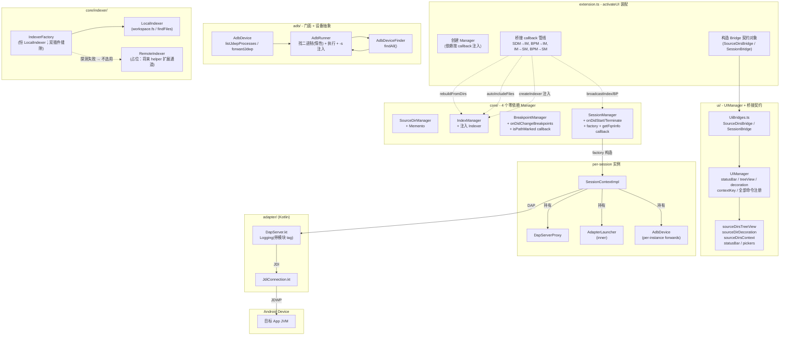
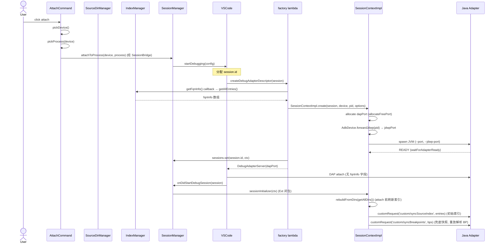
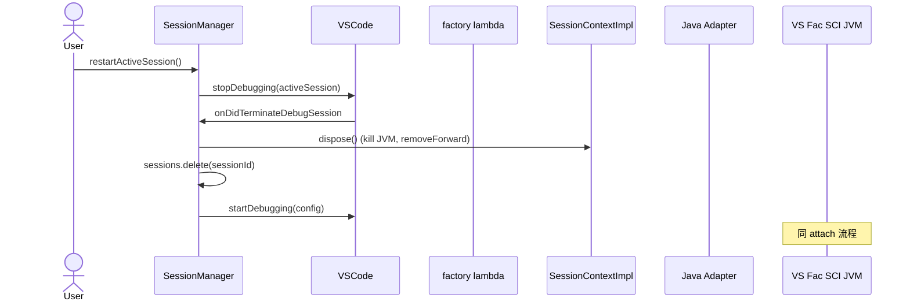
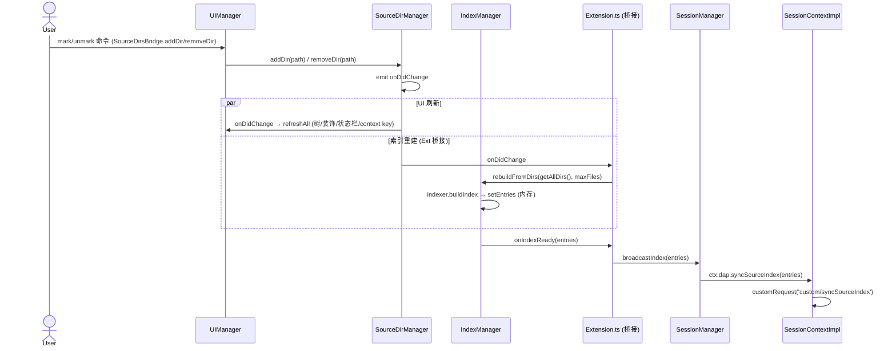
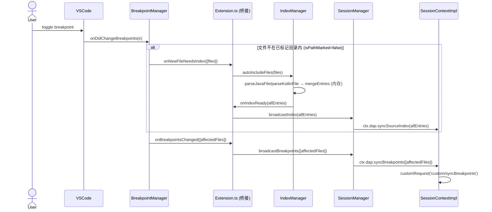
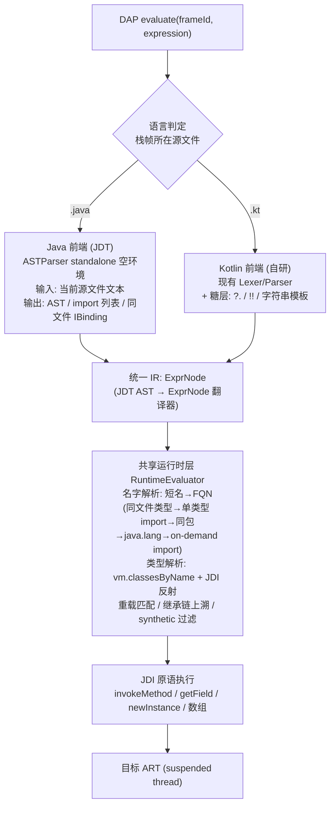

# Android Debugger 多会话架构设计

> 本文档记录重构后的多会话调试架构设计。
> MVP 已跑通，本设计将单例全局状态拆解为多 Manager 协作架构，支持多会话并发调试。

---

## 一、核心设计决策

### 1.1 关键洞察：资源创建点下沉到 `createDebugAdapterDescriptor`

```mermaid
flowchart LR
    A["attach 按钮点击"] --> B["UI 交互阶段<br/>pickDevice + pickProcess"]
    B --> C["build session config<br/>(__device + __pid + fqnInfo)"]
    C --> D["startDebugging(config)"]
    D --> E["VSCode 分配 session.id"]
    E --> F["createDebugAdapterDescriptor(session)"]
    F --> G["new SessionContextImpl(session)<br/>分配 dapPort / jdwpPort<br/>forwardJdwp + spawn JVM"]
    G --> H["sessions.set(session.id, ctx)"]
    H --> I["返回 DebugAdapterServer(dapPort)"]
    I --> J["VSCode 连接 JVM"]
    J --> K["onDidStartDebugSession fires<br/>sessionInitializer 兜底"]
```



关键点：

1. **SessionContextImpl 在 `createDebugAdapterDescriptor` 内部构造**。此时 `session.id` 已存在，可直接作为 `sessions: Map<sessionId, SessionContextImpl>` 的 key，**无需 attachId / sessionToken**。
2. **端口分配、JVM 启动、JDWP forward 全部在 SessionContextImpl 构造时完成**。factory 本身无状态，只读 config 返回 `DebugAdapterServer(dapPort)`。
3. **SessionContextImpl 拥有自己的所有资源**（proc / jdwpController / dapPort / jdwpPort）。其他模块不持有它的引用，只能通过 SessionManager 的 sessions Map 查询。

### 1.2 索引传递模型：纯内存 + 会话初始化时 `custom/syncSourceIndex` 推送


关键点：

- **`IndexManager` 完全在内存**（单数组 `entries`），生命周期 = 插件生命周期。
- **初始索引经 `sessionInitializer` 推送**：会话 `onDidStartDebugSession` 触发时，extension.ts 的 initializer 闭包**先按当前已标记目录重建索引**（激活后除 mark/unmark 外没有其他重建触发点；重构前流程也是每次 attach 现建索引），再经 `ctx.dap.syncSourceIndex(entries)`（DAP `custom/syncSourceIndex` 自定义请求）写入 adapter，并同步兜底断点快照（`custom/syncBreakpoints` 会基于已就位的索引重放解析 BP → `verified=true`）。
- **`fqnInfo`-on-attach 通道休眠**：设计稿原方案是把快照写进 session config `fqnInfo` 字段、由 adapter `handleAttach` 加载；实现演化为 initializer 推送后，TS 侧不再写 config `fqnInfo`（`SessionContextOptions.fqnInfo` 仍构造但当前无消费点），Kotlin `handleAttach` 的 `fqnInfo` 解析保留为休眠兼容路径。
- adapter 的 `pendingJdiBps` 暂存机制保证：`setBreakpoints` 早于索引到达时先暂存，JDI attach 完成后 drain 重放，BP 能正确 resolve/verified。
- 源目录变化 → `IndexManager` 内存重建 → emit `onIndexReady` → Extension 桥接 → `SessionManager.broadcastIndex` → 所有活跃会话的 `dap.syncSourceIndex`（**不是**重启）。
- 跨 VSCode 实例零冲突（entries 走 DAP 内存，不写共享文件）。

### 1.3 设计原则（决策汇总）

| # | 原则 | 具体表现 |
|---|------|---------|
| 1 | **Manager 零相互依赖** | 四个 Manager（SourceDir / Index / Breakpoint / Session）互相不 import、不持有彼此实例；所有跨 Manager 通信由 extension.ts 的 callback 桥接完成 |
| 2 | **Callback 即接口** | Manager 只暴露两类东西：事件（`onXxx` 供外部订阅）与方法（供外部桥接调用）；跨 Manager 的数据获取一律注入 callback（如 `getFqnInfo`、`isPathMarked`），而不是注入 Manager 实例 |
| 3 | **自己的活自己干** | `BreakpointManager` 自己注册 `onDidChangeBreakpoints`；`SessionManager` 自己注册 `onDidStart/Terminate` 和 factory；`IndexManager` 拥有 entries 快照与重建；`SourceDirManager` 拥有 Memento 存储与 legacy 迁移 |
| 4 | **VSCode 回调归各 Manager** | 见 §1.4 |
| 5 | **Extension.ts 只做装配 + 桥接** | `activateUI` 创建 Manager、注入依赖、接 callback 管线；不注册任何领域内 VSCode 回调、不注册用户命令 |
| 6 | **Manager 按需最小注入** | 不统一塞 `ExtensionContext`：`SourceDirManager` 只拿 `workspaceState`，`BreakpointManager` 只拿订阅回调所需的 `context`，`SessionManager` 只拿 `javaPath` / `adbRunner` / `getFqnInfo` |
| 7 | **UI 层零 Manager 引用** | `UIManager` / 各 UI 组件 / command handlers 只依赖 `UiBridges.ts` 里的 callback 契约（`SourceDirsBridge` / `SessionBridge`） |
| 8 | **资源 per-session 化** | SessionContextImpl 是 JVM / adb forward / dapPort / jdwpPort 的唯一所有者 |
| 9 | **adb 门面一体化** | `AdbRunner` 内聚"找二进制 + 执行命令"：构造只收配置值，二进制路径首次使用时惰性解析 |
| 10 | **数据契约独立成文件** | 跨模块共享的 wire 类型（`BreakpointTypes.ts` / `SessionContext.ts` / `Indexer.ts`）独立于任何 Manager，供多方 type-only import |

### 1.4 VSCode 回调归属

| 回调 | 归属 | 说明 |
|------|------|------|
| `vscode.debug.onDidStartDebugSession` | SessionManager | 会话初始状态推送（经 `setSessionInitializer` 回调取数） |
| `vscode.debug.onDidTerminateDebugSession` | SessionManager | 销毁会话 |
| `vscode.debug.registerDebugAdapterDescriptorFactory` | SessionManager | factory lambda 内部构造 SessionContextImpl |
| `vscode.debug.onDidChangeBreakpoints` | BreakpointManager | 监听断点变化、auto-include 检测 |
| `vscode.window.registerFileDecorationProvider` / `createTreeView` | UIManager | 树视图 + 文件装饰 |
| `vscode.commands.registerCommand` | UIManager | 全部 7 个用户命令（含 attach / restartSession） |
| `vscode.workspace.onDidChangeWorkspaceFolders` 等 | 各 Manager | 谁关心谁注册 |

---

## 二、完整架构图



> 依赖规则：实线 = 组合/调用（同层内），虚线 = 经 extension.ts 桥接的 callback 流。**虚线两端的对象互不 import**——`SourceDirsBridge` / `SessionBridge` / `getFqnInfo` / `isPathMarked` 都是普通函数契约。

---

## 三、目录结构

```
src/
├── adb/
│   ├── AdbRunner.ts               # adb 门面: findAdb(惰性解析) + DefaultAdbRunner(exec/start, -s 注入)
│   ├── AdbDeviceFinder.ts         # 设备发现: findAll() → AdbDevice[]
│   └── AdbDevice.ts               # 单设备封装: listJdwpProcesses / forwardJdwp / removeForward
│
├── commands/
│   ├── attach.ts                  # 纯 UI: pickDevice + pickProcess + 经 bridge 回调 attach
│   └── markSourceDir.ts           # mark / unmark (吃 SourceDirsBridge)
│
├── core/
│   ├── SourceDirManager.ts        # 源目录 + Memento (URI 字符串存储) + legacy config 迁移
│   ├── BreakpointManager.ts       # 断点事件 + onDidChangeBreakpoints (isPathMarked 注入)
│   ├── BreakpointTypes.ts         # 断点 wire 类型契约 (BreakpointEntry / BreakpointFile)
│   ├── IndexManager.ts            # entries 快照 + rebuildFromDirs + autoIncludeFiles
│   ├── SessionManager.ts          # 会话 Map + onDidStart/Terminate + factory + 广播
│   ├── indexer/
│   │   ├── Indexer.ts             # 接口 (Indexer, IndexOptions, FqnEntry)
│   │   ├── IndexerFactory.ts      # 策略选择（现恒 LocalIndexer；双插件架构对接缝隙）
│   │   ├── LocalIndexer.ts        # 唯一在用实现 (findFiles/ workspace.fs 双策略 + parseJava/parseKotlinFile)
│   │   └── RemoteIndexer.ts       # 占位实现（将来 workspace 宿主 helper 扩展通道）
│   └── session/
│       ├── SessionContext.ts      # 会话上下文接口 + DeviceInfo/ProcessInfo
│       ├── SessionContextImpl.ts  # 会话上下文实现 (含 AdapterLauncher inner class)
│       └── DapServerProxy.ts      # DAP customRequest 封装
│
├── i18n/                          # strings.ts 词条表
│
├── ui/
│   ├── UIManager.ts               # UI 装配: statusBar/treeView/decoration/contextKey + 全部命令
│   ├── UiBridges.ts               # 桥接契约: SourceDirsBridge / SessionBridge
│   ├── statusBar.ts               # attach 状态 + 目录计数
│   ├── sourceDirsTreeView.ts      # "源文件目录"树视图
│   ├── sourceDirDecoration.ts     # ⚡ 文件装饰
│   ├── sourceDirsContext.ts       # sourceDirPaths context key (菜单 when)
│   ├── devicePicker.ts            # 设备选择 (单设备自动跳过)
│   └── processPicker.ts           # 进程选择
│
├── util/                          # logger / config / jdk / port / indexFile / uri ...
│
└── extension.ts                   # activateUI 装配 (扩展只跑 UI 宿主，无分发)
```

---

## 四、组件职责

| 组件 | 位置 | 类型 | 职责 |
|------|------|------|------|
| AdbRunner | adb/ | 门面 | 找 adb 二进制（惰性解析）+ spawn/exec + `-s` 注入 + 超时/日志截断 |
| AdbDeviceFinder | adb/ | 独立 | `adb devices` 解析 → `AdbDevice[]` |
| AdbDevice | adb/ | 独立 | 单设备操作：JDWP 进程枚举、forward 簿记（per-instance） |
| SourceDirManager | core/ | 独立 | 源目录 Memento 存储（URI 字符串）+ legacy config 迁移 + 变更事件 |
| IndexManager | core/ | 独立 | entries 快照 + `rebuildFromDirs`（走注入的 Indexer）+ `autoIncludeFiles` |
| BreakpointManager | core/ | 独立 | 注册 onDidChangeBreakpoints + 解析 + 两个事件（isPathMarked 注入，断点键 = canonical path） |
| BreakpointTypes | core/ | 契约 | 断点 wire 类型，供 SessionManager / DapServerProxy type-only import |
| SessionManager | core/ | 独立 | 注册 onDidStart/Terminate + factory + restart + 广播（getFqnInfo 注入） |
| Indexer | core/indexer/ | 接口 | 索引策略（为将来 helper 扩展 fast path 保留缝隙） |
| IndexerFactory | core/indexer/ | 工厂 | 策略选择：探测远程索引 provider，探测失败降级 LocalIndexer + onFallback |
| LocalIndexer | core/indexer/ | 实现 | 唯一在用实现：工作区内走 `findFiles`（远程批量在远端执行），区外走 `vscode.workspace.fs` 递归 |
| RemoteIndexer | core/indexer/ | 占位 | 将来转发给 workspace 宿主 helper 扩展（`RemoteIndexApi` 结构化契约内联定义） |
| SessionContext | core/session/ | 接口 | 会话上下文契约 + DeviceInfo/ProcessInfo |
| SessionContextImpl | core/session/ | per-session | 资源所有者（JVM/forward/端口）+ static create() 异步工厂 |
| DapServerProxy | core/session/ | per-session | DAP customRequest 封装 |
| AdapterLauncher | core/session/ | inner | spawn JVM（SessionContextImpl 私有；TCP 模式日志走 JVM stdout） |
| UIManager | ui/ | UI 装配 | statusBar/treeView/decoration/contextKey + 全部命令注册（只依赖 Bridge 契约） |
| UiBridges | ui/ | 契约 | SourceDirsBridge / SessionBridge callback 接口 |
| uri.ts | util/ | 工具 | 路径模型核心：canonical key / URI 字符串解析 / 归属判断 / context 多形态 |
| extension.ts | 根目录 | 装配 | activateUI（创建 Manager、callback 桥接、Bridge 构造）；remote 窗口仅提示索引降级模式 |

---

## 五、接口设计

### 5.0 adb/ 模块（三件套）

**AdbRunner.ts** —— adb 门面：内聚"找二进制 + 执行命令"，并统一注入 `-s <serial>`。

```typescript
// src/adb/AdbRunner.ts
export interface AdbRunner {
  /** 执行 adb 命令。传 serial 时自动前置 `-s <serial>`（全局命令如 devices 不传）。 */
  exec(args: string[], serial?: string): Promise<AdbResult>;
  /** exec + stdin（如 shell 输入）。 */
  execWithStdin(args: string[], stdin: string, serial?: string): Promise<AdbResult>;
  /** spawn adb 长进程（如 `adb jdwp`）。 */
  start(args: string[], serial?: string): ChildProcess;
}

export class DefaultAdbRunner implements AdbRunner {
  private resolvedPath: string | undefined;

  /**
   * @param configuredPath 来自配置的 adb 路径；'auto'（默认）表示先探测运行中的
   *   adb server，再退化到 $PATH。
   */
  constructor(private readonly configuredPath: string = 'auto') {}

  /** 首次使用时才解析二进制路径（惰性，缓存一次）。 */
  private get adbPath(): string {
    this.resolvedPath ??= findAdb(this.configuredPath);  // findAdb 为模块私有
    return this.resolvedPath;
  }
  // exec / execWithStdin / start 均经 run()：超时 SIGKILL + stdout/stderr 日志截断
}
```

> `findAdb` 及探测链（`which adb` → `$ANDROID_HOME/platform-tools` → `$PATH`）是模块私有实现细节，外部只 `new DefaultAdbRunner(configuredPath)`。

**AdbDeviceFinder.ts** —— 设备发现：

```typescript
// src/adb/AdbDeviceFinder.ts
export class AdbDeviceFinder {
  constructor(private readonly runner: AdbRunner) {}
  /** 解析 `adb devices` → 设备数组；adb 本身不可用时返回 []。 */
  async findAll(): Promise<AdbDevice[]> { /* ready/offline/unauthorized 分类 */ }
}
```

**AdbDevice.ts** —— 单设备封装（per-instance forward 簿记）：

```typescript
// src/adb/AdbDevice.ts
export interface JdwpProcess { pid: number; name: string; }

export class AdbDevice {
  constructor(
    private readonly runner: AdbRunner,
    readonly serial: string,
    readonly state: string = 'unknown'
  ) {}

  async listJdwpProcesses(): Promise<JdwpProcess[]>;   // `adb jdwp` 抓 PID(1s 窗口) + `ps -A` 补名字
  async forwardJdwp(pid: number): Promise<number>;     // allocatePortWithRetry + forward，登记 activeForwards
  async removeForward(port: number): Promise<void>;    // forward --remove + 注销
  async cleanupAllForwards(): Promise<void>;           // 清空本实例全部 forward
  getActiveForwardCount(): number;
}
```

所有设备级命令经 `runner.exec(args, this.serial)` 执行，**`-s` 由 runner 注入**（见 D12）。设备发现返回 `AdbDevice` 实例，调用方不再手工拼 serial。

### 5.1 remote/ 与 IndexerFactory（缝隙保留，实现留空）

> **`UiExtApi` 已删除**（多会话重构）：多会话前"workspace → UI 反向推送初始索引"的遗留通道。Memento 按 host 隔离导致该通道天然失效；且 UI 侧 `setSessionInitializer` 本就会在 attach 时经 session config `fqnInfo` 推送索引，双向推送构成竞态。**索引单一写入口 = UI 侧**。
>
> **workspace 侧实现（`remote/DebugRemoteApi(Impl).ts`）已删除留空**（Remote-SSH 修复，见 §九）：原方案是"同 ID 双宿主，UI 侧经 `exports` 调 workspace 半边"——但 `extensionKind` 数组只是偏好序，VSCode **只选一个宿主**加载扩展（`["ui","workspace"]` 实际只跑 UI 宿主，workspace 半边根本不激活），且官方文档明确**跨宿主 `exports` 不可达**（"the API from the provider is not available to the consumer"），整条链路不可实现。
>
> **`IndexerFactory` / `RemoteIndexer` 保留为将来的对接缝隙**：按规划将来采用**双插件架构**——一个 `extensionKind: ["workspace"]` 的 helper 扩展在 workspace 宿主原生跑索引，主插件经跨宿主通道调用。落地时：`extensionId` 指向 helper 扩展 ID、以 helper 的 API 类型（大概率走 `vscode.commands` 跨宿主转发）替换 `RemoteIndexer.ts` 内联的 `RemoteIndexApi` 结构化契约，`createIndexer` 即返回 `RemoteIndexer`。当前 `createIndexer` 探测不到 provider，恒返回 `LocalIndexer` 并触发 `onFallback`。

### 5.2 Indexer（core/indexer/）

```typescript
// src/core/indexer/Indexer.ts
export interface Indexer {
  buildIndex(dirs: string[], options: IndexOptions): Promise<FqnEntry[]>;
  dispose(): void;
}
```

> `Indexer` 接口 + `RemoteIndexer` 占位构成策略缝隙：将来双插件架构（workspace 宿主 helper 扩展原生跑索引）落地时，只需 `IndexerFactory` 返回 `RemoteIndexer`，其余代码不动。

```typescript
// src/core/indexer/LocalIndexer.ts —— 唯一在用实现
export class LocalIndexer implements Indexer {
  /**
   * @param dirs 已标记源目录（URI 字符串，见 §5.4）
   */
  async buildIndex(dirs: string[], options: IndexOptions): Promise<FqnEntry[]> {
    // 每个目录两条策略：
    //   - 目录属于某个 workspace folder → vscode.workspace.findFiles(RelativePattern(dirUri))
    //     glob 在文件系统 provider 一侧批量执行（Remote-SSH 时跑在远端，一次结果集往返）
    //   - 目录在工作区外 → vscode.workspace.fs.stat + readDirectory 递归
    //     （UI 宿主也能透明触达远程 FS；Node fs 只能看本机磁盘，已弃用）
    // 读取/解析: vscode.workspace.fs.readFile + parseJavaFile/parseKotlinFile
    // entries 的 file 字段 = canonicalPath(uri)（见 §5.4 路径模型）
  }
  dispose(): void {}
}
export function parseJavaFile(text: string, uri: vscode.Uri): string[] { /* ... */ }
export function parseKotlinFile(text: string, uri: vscode.Uri): string[] { /* ... */ }
```

### 5.3 IndexManager（核心）

**纯内存实现**，不维护任何持久化文件。索引条目通过 DAP attach 请求的 `fqnInfo` 字段传给 JVM（见 §1.2）。**不监听任何 VSCode 事件、不持有其他 Manager**——重建由 extension.ts 桥接触发，Indexer 策略由构造注入。

```typescript
// src/core/IndexManager.ts
import { Indexer, FqnEntry } from './indexer/Indexer';

export type IndexReadyCallback = (entries: FqnEntry[]) => void;

export class IndexManager {
  private entries: FqnEntry[] = [];
  private readonly emitter = new vscode.EventEmitter<FqnEntry[]>();

  /**
   * @param indexer 索引策略，由激活入口经 IndexerFactory 创建后注入一次。
   *   Manager 自己不感知运行环境。
   */
  constructor(private readonly indexer: Indexer) {}

  // ========== 查询 ==========

  /** 给 SessionManager factory 用：当前 entries 快照 → DAP attach arguments */
  getAllEntries(): FqnEntry[] { return this.entries; }

  resolveByFqn(fqn: string): { file: string } | undefined { /* 线性查找 entries */ }
  resolveFqnsByFile(file: string): string[] { /* 同上，按 file 过滤 */ }

  // ========== 数据操作（均由外部桥接调用） ==========

  /** 全量重建：给定的已标记源目录 → indexer.buildIndex → setEntries。
   *  仅数据面；UI 刷新（树/装饰/状态栏/context key）是 UIManager 的事。 */
  async rebuildFromDirs(dirs: string[], maxFiles: number): Promise<void> {
    if (dirs.length === 0) { this.setEntries([]); return; }
    try {
      const entries = await this.indexer.buildIndex(dirs, { maxFiles });
      this.setEntries(entries);
    } catch (e) { Logger.error(`[index] rebuild failed`, e as Error); }
  }

  /** auto-include：解析不在已标记目录下的 java/kt 文件并合并（收 vscode.Uri[]）。 */
  async autoIncludeFiles(uris: vscode.Uri[]): Promise<void> {
    // vscode.workspace.fs.readFile（远程可达）→ parse → mergeEntries(out)
  }

  private setEntries(entries: FqnEntry[]): void { /* 覆盖 + emit(this.entries) */ }
  private mergeEntries(more: FqnEntry[]): void { /* 追加去重 + emit */ }

  // ========== 事件 ==========

  onIndexReady(cb: IndexReadyCallback): vscode.Disposable { return this.emitter.event(cb); }

  dispose(): void { this.emitter.dispose(); this.indexer.dispose(); }
}
```

### 5.4 BreakpointManager

数据契约独立在 `core/BreakpointTypes.ts`，供 `SessionManager` / `DapServerProxy` / extension.ts type-only import：

```typescript
// src/core/BreakpointTypes.ts
export interface BreakpointEntry {
  line: number;
  condition?: string;
  logMessage?: string;
  enabled: boolean;
}

export interface BreakpointFile {
  source: { path: string };
  breakpoints: BreakpointEntry[];
}

export type BreakpointsChangeCallback = (files: BreakpointFile[]) => void;
/** 触发了未覆盖目录文件断点的 URI 列表（auto-include 用）。 */
export type NewFileNeedsIndexCallback = (uris: vscode.Uri[]) => void;
```

```typescript
// src/core/BreakpointManager.ts
import { BreakpointEntry, BreakpointFile, BreakpointsChangeCallback, NewFileNeedsIndexCallback } from './BreakpointTypes';

export class BreakpointManager {
  private readonly bpEmitter = new vscode.EventEmitter<BreakpointFile[]>();
  private readonly indexEmitter = new vscode.EventEmitter<vscode.Uri[]>();
  private current: Map<string, BreakpointEntry[]> = new Map();

  constructor(
    context: vscode.ExtensionContext,
    /**
     * 桥接 callback：判断文件 URI 是否已被某个已标记源目录覆盖。
     * 注入而非持有 SourceDirManager —— Manager 之间零依赖。
     */
    private readonly isPathMarked: (file: vscode.Uri) => boolean
  ) {
    this.refreshCurrent();
    context.subscriptions.push(
      vscode.debug.onDidChangeBreakpoints((e) => this.handleChange(e)),
      this.bpEmitter,
      this.indexEmitter,
    );
  }

  onBreakpointsChanged(cb: BreakpointsChangeCallback): vscode.Disposable {
    return this.bpEmitter.event(cb);
  }

  onNewFileNeedsIndex(cb: NewFileNeedsIndexCallback): vscode.Disposable {
    return this.indexEmitter.event(cb);
  }

  /** 当前断点快照（含禁用断点），供 sessionInitializer 兜底同步。 */
  getCurrentBreakpoints(): BreakpointFile[] { /* Map → BreakpointFile[] */ }

  private refreshCurrent(): void { /* vscode.debug.breakpoints → current */ }
  private handleChange(e: vscode.BreakpointsChangeEvent): void {
    // - 新文件（uri.path 以 .java/.kt 结尾）且 isPathMarked(uri)=false
    //   → indexEmitter 发 URI（auto-include）
    // - 变化文件 → bpEmitter，source.path = canonicalPath(loc.uri)
    //   （file: URI → fsPath；vscode-remote: 等 → uri.path，见 §5.4 路径模型）
  }
}
```

### 5.5 SourceDirManager

**纯数据组件**：Memento 存储（**URI 字符串**）+ legacy 配置迁移 + 变更事件。不再持有任何 UI 组件——StatusBar / TreeView / Decoration 全部归 UIManager（见 §5.5.1），UI 经 `SourceDirsBridge`（§六）以 callback 形式消费它。

```typescript
// src/core/SourceDirManager.ts
export type DirsChangeCallback = () => void;

export class SourceDirManager {
  private readonly emitter = new vscode.EventEmitter<void>();
  private migrated = false;

  constructor(private readonly store: vscode.Memento) {}

  onDidChange(listener: DirsChangeCallback): vscode.Disposable { return this.emitter.event(listener); }

  /** 全部已标记目录（URI 字符串；legacy 条目读取时升级为 URI 形态并回写）。 */
  async getAllDirs(): Promise<string[]> { /* upgradeAndRead + migrateLegacyConfigIfNeeded */ }
  /** 精确匹配（URI 归一化比较 + Windows 大小写不敏感）。 */
  contains(dir: vscode.Uri): boolean { /* dirUriEquals 遍历 */ }
  /** 已被某已标记目录覆盖时返回该目录（URI 字符串，markSourceDir 去重用）。 */
  findCoveringAncestor(dir: vscode.Uri): string | undefined { /* isUnderDir 遍历 */ }
  /** 文件 URI 是否落在某个已标记目录内（auto-include 门）。 */
  isPathMarked(file: vscode.Uri): boolean { /* isUnderDir 遍历 */ }

  async addDir(dir: vscode.Uri): Promise<void> { /* 归一化写 Memento + emit */ }
  /**
   * 宽容删除：对 URI 字符串 / uri.path / fsPath（Windows 大小写不敏感）
   * 全形态匹配 legacy 与错误存储的条目。返回是否真的删掉了东西 ——
   * 即使存储路径是错的，unmark 也必须能工作（不再有 contains 前置拦截）。
   */
  async removeDir(target: vscode.Uri): Promise<boolean> { /* 多形态过滤 + emit */ }

  private async migrateLegacyConfigIfNeeded(): Promise<void> { /* settings.json 旧配置 → Memento 一次性迁移 */ }
}
```

#### 路径模型（util/uri.ts，Remote-SSH 修复的核心）

| 概念 | 形态 | 用途 |
|------|------|------|
| **存储形态** | URI 字符串 `uri.toString()`（如 `vscode-remote://ssh-remote%2Bhost/home/liux/x`） | Memento 源目录条目；Windows UI 宿主上 `uri.fsPath` 会把远程 URI 毁成 `\home\liux\x`（`path.resolve` 再补个假 `C:` 前缀），URI 字符串无损 |
| **canonical key** | `file:` → `uri.fsPath`（保持本地历史行为 `C:\x\Y.java`）；其余 scheme → `uri.path`（`/home/liux/Y.java`） | 索引条目 `file` 字段 + 断点 payload `source.path`（adapter normalize 后的内部键） + Kotlin adapter 内部键 |
| **回显形态** | `file:` → fsPath；其余 → **完整 URI 字符串**（`clientPath(uri)` / 索引条目 `sourceUri` 字段 / adapter `displayPathByFile`） | **adapter 回显给 VSCode 的 DAP `source.path` 必须用这个形态**——bare posix 路径在 Windows 客户端被解析成本机路径（`\home\...`），堆栈帧打不开文件、verified 断点无法定位回文件（灰色不亮）；VSCode 自己发 setBreakpoints 用的就是完整 remote URI，回显原样奉还即可解析 |
| **adapter 归一化** | `normalizeSourcePath`：剥离 `vscode-remote://<authority>` / `file://<authority>` 前缀 | VSCode 标准 `setBreakpoints` 在远程窗口发的 `source.path` 是完整 URI，归一化后与索引键对齐 |
| **context 多形态** | `dirContextForms`：URI 字符串 / `uri.path` / `fsPath` 全形态超集 | `vscode-android-debugger.sourceDirPaths` context key，`resourcePath in <set>` 在本地/远程窗口都能命中 |

#### 5.5.1 UIManager 与 UiBridges

UI 层与 core 的唯一接触面是 `ui/UiBridges.ts` 的两个 callback 契约（数据契约 `DeviceInfo/ProcessInfo` 为 type-only import）：

```typescript
// src/ui/UiBridges.ts
export interface SourceDirsBridge {
  getDirs(): Promise<string[]>;                     // URI 字符串
  contains(dir: vscode.Uri): boolean;
  findCoveringAncestor(dir: vscode.Uri): string | undefined;
  addDir(dir: vscode.Uri): Promise<void>;
  removeDir(dir: vscode.Uri): Promise<boolean>;
  isPathMarked(file: vscode.Uri): boolean;
  onDidChange(cb: () => void): vscode.Disposable;
}

export interface SessionBridge {
  attachToProcess(device: DeviceInfo, process: ProcessInfo): Promise<boolean>;
  restartActiveSession(): Promise<void>;
}
```

`UIManager` 持有全部 workbench 面：`StatusBarManager`（attach 状态 + 目录计数 + 索引降级标记）、`SourceDirsTreeProvider`（源文件目录树）、`SourceDirDecorationProvider`（⚡文件装饰）、`sourceDirsContext` context key（explorer 菜单 `when`），并注册全部 7 个用户命令（mark/unmark/unmarkFromDir/revealInExplorer/openExplorer/attach/restartSession）。构造参数只有 `{ dirs: SourceDirsBridge, session: SessionBridge }`；`onDidChange` 触发所有 UI 面统一刷新。

`commands/` 下的 handler 同样只吃 bridge/callback：`AttachCommandDeps = { attachToProcess, restartActiveSession, statusBar }`。设备/进程选择器（`devicePicker.ts` / `processPicker.ts`）独立成模块，设备选择在只有一个 ready 设备时自动跳过。

### 5.6 SessionContext（接口）

```typescript
// src/core/session/SessionContext.ts
export interface DeviceInfo {
  serial: string;
  state?: string;
}

export interface ProcessInfo {
  pid: number;
  name?: string;
}

/** 单个调试会话运行期上下文的只读视图。广播循环只看 session/device/process，
 *  JVM 生命周期与 adb forward 状态藏在 SessionContextImpl 后面。 */
export interface SessionContext {
  readonly session: vscode.DebugSession;
  readonly device: DeviceInfo;
  readonly process: ProcessInfo;
  readonly dapPort: number;
  readonly jdwpPort: number;
  readonly dap: DapServerProxy;
}
```

### 5.7 DapServerProxy

自定义 DAP 请求统一加 `custom/` 前缀（wire 层防与标准 DAP 命令冲突；TS 方法名保持干净形式）：

```typescript
// src/core/session/DapServerProxy.ts
export class DapServerProxy {
  constructor(private readonly session: vscode.DebugSession) {}

  /** 全量推送断点快照（adapter 重放放置 → 回 verified 事件）。 */
  syncBreakpoints(files: BreakpointFile[]): Promise<unknown> {
    return Promise.resolve(this.session.customRequest('custom/syncBreakpoints', { files }));
  }

  /** 全量替换 SourceIndex（fqn → file）。 */
  syncSourceIndex(entries: FqnEntry[]): Promise<unknown> {
    return Promise.resolve(this.session.customRequest('custom/syncSourceIndex', { entries }));
  }
}
```

> 命名修订（2026-09）：原 `sourceDirs/set` → `custom/syncSourceIndex`（payload 是 fqn→file 索引条目而非目录，正名）；原 `sourceDirs/add`（增量合并）为死命令，双侧删除。

### 5.8 SessionContextImpl

per-session 资源所有者。私有构造 + `static create()` 异步工厂（端口分配 / forward / JVM 就绪等待都是异步步骤，失败时工厂内部负责清理半成品）。

```typescript
// src/core/session/SessionContextImpl.ts
export interface SessionContextOptions {
  javaPath: string;
  jarPath: string;
  /**
   * 索引条目快照（来自 getFqnInfo 回调）。
   * 注意：attach-arguments 通道休眠后此字段当前无消费点（初始索引实际经
   * sessionInitializer 的 dap.syncSourceIndex 推送，见 §1.2），保留待清理或复用。
   */
  fqnInfo: FqnEntry[];
  /** adb 执行器；可跨会话共享（无状态） */
  adbRunner: AdbRunner;
}

export class SessionContextImpl implements SessionContext {
  readonly session: vscode.DebugSession;
  readonly device: DeviceInfo;
  readonly process: ProcessInfo;
  readonly dapPort: number;
  readonly jdwpPort: number;
  readonly dap: DapServerProxy;

  private readonly adapterProc: ChildProcess;
  private readonly adbDevice: AdbDevice;   // per-session（持有 activeForwards）
  private disposed = false;

  private constructor(session, device, process, jdwpPort, adbDevice, dapPort, adapterProc) {
    // ... 纯赋值 + new DapServerProxy(session)
  }

  /** 异步工厂：alloc dapPort → per-session AdbDevice.forwardJdwp(pid) → spawn JVM → waitForAdapterReady(10s)。
   *  任何一步失败：kill JVM + removeForward，然后 rethrow（调用方无需半成品清理）。 */
  static async create(
    session: vscode.DebugSession,
    device: DeviceInfo,
    process: ProcessInfo,
    options: SessionContextOptions
  ): Promise<SessionContextImpl> { /* ... */ }

  /** 解析打包的 adapter.jar（resources/adapter.jar 或仓库内 adapter/build/libs）。 */
  static resolveAdapterJar(extensionPath: string): string { /* ... */ }

  dispose(): void {
    // 幂等：kill adapterProc + adbDevice.removeForward(jdwpPort)（异步、容错）
  }
  isDisposed(): boolean { return this.disposed; }
}
```

模块级（非类成员）辅助函数：

- `allocateFreePort()` —— `net.createServer().listen(0)` 抓空闲端口（替代旧 PortAllocator inner class）。
- `waitForAdapterReady(proc, timeoutMs)` —— 监听 stdout/stderr 中的 `READY`（TCP 模式下 adapter 日志走 stdout，见 §5.10）。
- `AdapterLauncher`（inner class）—— spawn JVM（UTF-8 编码参数）+ 透传日志：stdout 标 `[adapter]`，stderr 标 `[adapter stderr]`；`resolveAdapterJar` 亦在此。

> 旧设计的 `AdbJdwpController` inner class 已被 `adb/AdbDevice.ts` 取代（§5.0）：设备抽象独立成模块后可被 attach 命令复用，forward 簿记 per-instance 语义不变。`SessionContextImpl.PortAllocator` 命名空间仅为遗留 call site 兼容保留。

### 5.9 SessionManager

```typescript
// src/core/SessionManager.ts
export interface SessionManagerDeps {
  /** 不传则运行时 detectJdk('auto') */
  javaPath?: string;
  /** 不传则运行时 new DefaultAdbRunner()（惰性解析 adb 路径） */
  adbRunner?: AdbRunner;
  /**
   * 桥接 callback：为 DAP attach 请求提供 FQN 索引快照。
   * 由激活入口注入 —— SessionManager 不持有 IndexManager
   * （Manager 之间零依赖，全部经外部桥接的 callback 通信）。
   */
  getFqnInfo?: () => FqnEntry[];
}

export type SessionInitializerCallback = (ctx: SessionContext) => Promise<void> | void;

export class SessionManager {
  private sessions = new Map<string, SessionContextImpl>();
  private sessionInitializer?: SessionInitializerCallback;

  constructor(private deps: SessionManagerDeps) {}

  /** VM 已从 attach arguments 的 fqnInfo 加载索引；initializer 只做兜底同步断点等。 */
  setSessionInitializer(cb: SessionInitializerCallback): void { this.sessionInitializer = cb; }

  /** 注册 per-session 钩子（factory + start/terminate）；caller 负责把返回的 disposables 放进 context.subscriptions。 */
  register(context: vscode.ExtensionContext, extensionPath: string): vscode.Disposable[] {
    const disposables: vscode.Disposable[] = [];
    disposables.push(
      vscode.debug.registerDebugAdapterDescriptorFactory('android-java', {
        createDebugAdapterDescriptor: async (session) =>
          this.handleCreateDescriptor(session, extensionPath),
      })
    );
    disposables.push(
      vscode.debug.onDidStartDebugSession((s) => this.handleSessionStart(s)),
      vscode.debug.onDidTerminateDebugSession((s) => this.handleSessionTerminate(s)),
    );
    context.subscriptions.push(...disposables);
    return disposables;
  }

  // ========== factory lambda（SessionManager 私有） ==========

  private async handleCreateDescriptor(session, extensionPath): Promise<vscode.DebugAdapterServer> {
    const cfg = session.configuration as Record<string, unknown>;
    const existing = this.sessions.get(session.id);
    if (existing && !existing.isDisposed()) {
      // 同一 session 被再次询问（VSCode 瞬断重连）：直接复用已运行 JVM 的 DAP 端口
      return new vscode.DebugAdapterServer(existing.dapPort);
    }
    const ctx = await SessionContextImpl.create(
      session,
      this.readDevice(cfg),          // cfg.__device → { serial }
      this.readProcess(cfg),         // cfg.__pid/__processName → ProcessInfo
      await this.readOptions(extensionPath),
    );
    this.sessions.set(session.id, ctx);
    return new vscode.DebugAdapterServer(ctx.dapPort);
  }

  /** deps 缺省项的运行时兜底（javaPath 探测 / jarPath 解析 / getFqnInfo 回调）。 */
  private async readOptions(extensionPath: string): Promise<SessionContextOptions> {
    return {
      javaPath: this.deps.javaPath ?? await this.detectJava(),
      jarPath: SessionContextImpl.resolveAdapterJar(extensionPath),
      fqnInfo: this.deps.getFqnInfo?.() ?? [],   // 当前无消费点（见 §1.2）
      adbRunner: this.deps.adbRunner ?? this.detectAdbRunner(),
    };
  }

  // ========== 会话生命周期 ==========

  private async handleSessionStart(session): Promise<void> {
    if (session.configuration.type !== 'android-java') return;
    const ctx = this.sessions.get(session.id);
    if (!ctx) { Logger.warn(...); return; }
    await this.sessionInitializer?.(ctx);   // 失败仅记日志，不影响会话
  }

  private handleSessionTerminate(session): void {
    // type 过滤 → ctx.dispose() + sessions.delete
  }

  // ========== attach / restart ==========

  async attachToProcess(device: DeviceInfo, process: ProcessInfo): Promise<boolean> {
    // config: { type, request:'attach', __device: serial, __pid, __processName?, port: 0 占位 }
    // fqnInfo 不进 config —— 由 factory 经 getFqnInfo 回调现取（总是最新快照）
    return await vscode.debug.startDebugging(undefined, config);
  }

  async restartActiveSession(): Promise<void> {
    // activeDebugSession → ctx → stop + attachToProcess(ctx.device, ctx.process)
  }

  // ========== 广播（经 ctx.dap 即 DapServerProxy） ==========

  broadcastIndex(entries: FqnEntry[]): void { /* all ctx: ctx.dap.syncSourceIndex */ }
  broadcastBreakpoints(files: BreakpointFile[]): void { /* all ctx: ctx.dap.syncBreakpoints */ }

  disposeAll(): void { /* all ctx.dispose() + sessions.clear() */ }
}
```

> 与旧设计稿的差异：`register()` 把 factory/start/terminate 的注册从构造函数拆出（caller 显式调用，disposables 归 `context.subscriptions`）；`SessionContextImpl.create` 是 static 工厂（非 async constructor）；初始索引不走 config `fqnInfo`，由 extension.ts 的 `sessionInitializer` 经 `dap.syncSourceIndex` 推送（§1.2）；`options.fqnInfo` 仍构造但当前无消费点。

### 5.10 Kotlin adapter 侧配套改动（diff 摘要）

`fqnInfo` 走 DAP attach arguments 模式需要 adapter 端配合。两个文件改动：

**adapter/src/main/kotlin/.../Main.kt**

```diff
-fun main(args: Array<String>) {
-    val initialIndex = loadInitialIndex(args)   // 删
-    val jdwpPortOverride = ...
-    if (explicitPort != null) {
-        runTcp(explicitPort, executor, initialIndex, jdwpPortOverride)
-    } else {
-        runStdio(executor, initialIndex, jdwpPortOverride)
-    }
-}
-private fun loadInitialIndex(args: Array<String>): List<Map<String, String>> { ... }   // 删整个函数

+fun main(args: Array<String>) {
+    val jdwpPortOverride = ...
+    if (explicitPort != null) {
+        runTcp(explicitPort, executor, jdwpPortOverride)
+    } else {
+        runStdio(executor, jdwpPortOverride)
+    }
+}
```

**adapter/src/main/kotlin/.../DapServer.kt**

```diff
 class DapServer(
     private val executor: ExecutorService,
     private val transport: MessageTransport,
-    initialIndexEntries: List<Map<String, String>> = emptyList(),
     private val jdwpPortOverride: Int? = null,
 ) {
     private val indexer = SourceIndexer()
     ...
-    init {
-        if (initialIndexEntries.isNotEmpty()) {
-            indexer.add(initialIndexEntries)
-            Logging.info("已加载初始索引: ${initialIndexEntries.size} entries")
-        }
-    }

     private fun handleAttach(args: JsonObject): JsonObject {
         ...
         val conn = JdiConnection(host, port)
         val vm = conn.attach()
         jdi = conn
         bpManager = BreakpointManager(vm)
         stepController = StepController(vm)
         eventDispatcher = EventDispatcher(vm.eventQueue()) { ... }.also { it.start() }

+        // 加载 session config 传入的 fqnInfo；必须在 drainPendingBps 之前
+        args.get("fqnInfo")?.asJsonArray?.let { arr ->
+            val list = arr.map { el ->
+                val obj = el.asJsonObject
+                mapOf("fqn" to obj.get("fqn").asString, "file" to obj.get("file").asString)
+            }
+            indexer.add(list)
+            Logging.info("已加载初始索引: ${list.size} entries (来自 attach arguments)")
+        }
+
         drainPendingBps()
         return JsonObject()
     }
```

时序保证（见 §7.1）：

- VSCode 可能在 attach 处理完成前就发了 `setBreakpoints`（被 `pendingJdiBps` 暂存）
- `handleAttach` 中 JDI attach 完成后 `drainPendingBps()` 重放暂存 BP
- `sessionInitializer` 的 `custom/syncSourceIndex`（初始索引）经自定义请求到达后，索引就位、BP resolve FQN

> 休眠通道：`handleAttach` 中 `args.get("fqnInfo")` 的解析分支保留，但 TS 侧已不再往 config 写 `fqnInfo`，该分支当前恒为空——是 attach-arguments 原方案的兼容残留（见 §1.2）。
>
> Remote-SSH 配套：`handleSetBreakpoints` / `handleSyncBreakpoints` 的 `source.path` 现在统一经 **`normalizeSourcePath`** 归一化——剥离 `vscode-remote://<authority>` / `file://<authority>` 前缀，取裸路径作为内部键，与 TS 侧 canonical key（§5.4 路径模型）对齐；响应回显不受影响（`breakpoints` 响应不回显 source）。
>
> 平台无关 basename：JDI 侧 `findLocationsForLine` 用 `location.sourceName()`（如 `HTTPActivity.java`）与路径键的 basename 比对——统一走 `util/SourcePaths.kt#sourceBasename`，**按路径自身形态选分隔符**（含 `/` 用 `/` 切，否则 `\`；不依赖宿主 OS——键的风格由数据来源决定，Windows 宿主收 posix 键与 Linux 桌面宿主两场景皆覆盖）。原实现用 `File.separatorChar`，Windows 宿主 + posix 远程键时切不开 → 比对恒失败 → 断点永不生效。`custom/syncBreakpoints` 现把 `tryPlaceBp` 的真实 reason 落 INFO 日志（`placed=false reason=...`），事件 message 仅作粗粒度提示。
>
> 回显双轨：`FileEntry` 增加 `uri`（= TS 索引条目可选的 `sourceUri` 字段，远程窗口为 `vscode-remote://...` 完整 URI）；adapter 内部键保持 posix（与索引/registry 对齐），但**所有回显给 VSCode 的 DAP `source.path`**（breakpoint 事件、stopped 事件、stackTrace、loadedSources、BP payload）走 `displayPath`（`uri ?: path`，BP 侧另有 `displayPathByFile` 记录请求原样路径）——bare posix 回显在 Windows 客户端变 `\home\...`，导致堆栈帧找不到文件 + verified 断点无法点亮。

---

## 六、Extension.ts（activateUI 装配）

`extensionKind: ["ui", "workspace"]` 只是宿主偏好声明，VSCode **只选一个宿主**加载——本扩展实际只跑 UI 宿主（本地与 Remote-SSH 窗口皆然），`activate()` 无分发逻辑；`remoteName` 非空时仅把状态栏索引模式置为降级提示：

```typescript
// src/extension.ts
export async function activate(context: vscode.ExtensionContext): Promise<unknown> {
  const outputChannel = vscode.window.createOutputChannel(t.outputChannel());
  Logger.initialize(outputChannel);
  await activateUI(context);
  return undefined;
}

/**
 * 激活：构造 Manager → 接桥接管线 → 把 UI 面交给 UIManager。
 * JDK 预检只警告不失败 —— SessionManager 在 attach 时会惰性重探测。
 */
async function activateUI(context: vscode.ExtensionContext): Promise<void> {
  const config = getConfig();
  const jdk = await ensureJdkOrWarn(config.javaPath);   // util/jdk.ts（原 activateUI.ts 内聚）

  // 1) Manager（零相互依赖，全部 callback 注入）
  const dirsManager = new SourceDirManager(context.workspaceState);
  const breakpointManager = new BreakpointManager(context, (f) => dirsManager.isPathMarked(f));

  // Indexer 策略在此选择一次注入；remote 窗口探测失败 → onFallback 提示状态栏
  let ui: UIManager | undefined;   // 惰性引用：仅给 onFallback 兜底用
  const indexer = createIndexer({
    extensionId: context.extension.id,
    onFallback: () => ui?.statusBar.setIndexerMode('fallback'),
  });
  const indexManager = new IndexManager(indexer);

  const sessionManager = new SessionManager({
    javaPath: jdk?.javaPath,
    adbRunner: new DefaultAdbRunner(config.adbPath),
    getFqnInfo: () => indexManager.getAllEntries(),
  });

  // 2) Bridge 契约对象 —— UIManager 只见 callback，不见 Manager
  const dirsBridge: SourceDirsBridge = { /* getDirs/contains/findCoveringAncestor/addDir/removeDir/isPathMarked/onDidChange */ };
  const sessionBridge: SessionBridge = { /* attachToProcess / restartActiveSession */ };

  // 3) 外部桥接管线（Manager 唯一的相遇点）
  context.subscriptions.push(
    dirsManager.onDidChange(async () => {
      await indexManager.rebuildFromDirs(await dirsManager.getAllDirs(), config.indexMaxFiles);
    }),
    breakpointManager.onNewFileNeedsIndex((uris) => void indexManager.autoIncludeFiles(uris)),
    indexManager.onIndexReady((entries) => sessionManager.broadcastIndex(entries)),
    breakpointManager.onBreakpointsChanged((files) => sessionManager.broadcastBreakpoints(files)),
  );

  // 4) 会话初始化钩子（数据在闭包里取，不进 SessionManager）
  sessionManager.setSessionInitializer(async (ctx) => {
    // 先按当前已标记目录重建索引（激活后除 mark/unmark 外没有其他重建触发点；
    // 重构前流程也是每次 attach 现建索引），再推送快照
    await indexManager.rebuildFromDirs(await dirsManager.getAllDirs(), config.indexMaxFiles);
    const entries = indexManager.getAllEntries();
    if (entries.length > 0) await ctx.dap.syncSourceIndex(entries).catch(...);
    await ctx.dap.syncBreakpoints(breakpointManager.getCurrentBreakpoints()).catch(...);
  });

  // 5) UI 装配 + 远程窗口提示 + per-session 钩子注册
  const uiManager = new UIManager({ dirs: dirsBridge, session: sessionBridge });
  ui = uiManager;
  context.subscriptions.push(uiManager, indexManager);
  if (vscode.env.remoteName) {
    uiManager.statusBar.setIndexerMode('fallback');   // 索引走远程 FS 代理，能用但更慢
    Logger.warn(`remote window (${vscode.env.remoteName}): indexing via remote FS proxy`);
  }
  sessionManager.register(context, context.extensionPath);
  uiManager.registerCommands();
}
```

---

## 七、关键流程时序

### 7.1 attach 完整流程



### 7.2 restart 流程



### 7.3 sourceDirs 变更流程



### 7.4 断点变更（含 auto-include）



---

## 八、资源归属对比

| 资源 | 旧（单会话） | 新（多会话） |
|------|-------------|-------------|
| AdapterProcess | `factory.adapterProc` | `SessionContextImpl.adapterProc` |
| adb forward / 设备抽象 | `jdwpRegistry.controller` | `SessionContextImpl.adbDevice`（per-session `AdbDevice` + activeForwards） |
| dapPort | `factory.currentPort` | `SessionContextImpl.dapPort`（factory 仅读；同 session 重连时复用） |
| jdwpPort | `factory.currentJdwpPort` | `SessionContextImpl.jdwpPort` |
| Index 同步句柄 | `indexSyncRegistry.current` | absorbed into `SessionContextImpl` |
| Restart 上下文缓存 | `factory.{runner,pid,entries}` | 不需要，restart 走 stop+re-attach |
| 索引传递 | 每次 attach 临时写 `--index-file=<path>` | 纯内存快照，经 sessionInitializer 的 `custom/syncSourceIndex` 推送（attach-arguments 通道休眠） |
| Sessions Map | 无 | `SessionManager.sessions: Map<sessionId, SessionContextImpl>` |

---

## 九、迁移清单（已全部完成 ✅）

```
✅ src/debug/androidJavaFactory.ts          → 删除（factory 内联 SessionManager）
✅ src/debug/indexSync.ts                   → 删除
✅ src/debug/indexSyncRegistry.ts           → 删除
✅ src/debug/jdwpRegistry.ts                → 删除
✅ src/debug/adapterLauncher.ts             → 内联到 SessionContextImpl (inner class AdapterLauncher)
✅ src/debug/portAllocator.ts               → 内联为模块级 allocateFreePort()
✅ src/source/breakpointFiles.ts            → 删除（吸收到 BreakpointManager）
✅ src/source/indexer.ts                    → 拆成 core/indexer/{Indexer, LocalIndexer, RemoteIndexer, IndexerFactory}
✅ src/source/dirs.ts                       → 移到 core/SourceDirManager.ts
✅ src/source/decoration.ts                 → 移到 ui/sourceDirDecoration.ts
✅ src/source/treeView.ts                   → 移到 ui/sourceDirsTreeView.ts
✅ src/source/context.ts                    → 移到 ui/sourceDirsContext.ts
✅ src/extension.local.ts                   → 删除（拆成 extension.ts activateUI + ui/UIManager.ts + commands/）
✅ src/commands/attach.ts                   → 简化（pickDevice + pickProcess + SessionBridge 回调；restart 一并归入）
✅ src/commands/restartSession.ts           → 删除（合并到 SessionManager.restartActiveSession）
✅ src/extension.remote.ts                  → 移到 remote/DebugRemoteApiImpl.ts
✅ src/devices.ts / src/jdwp.ts             → 重构为 adb/AdbDeviceFinder.ts + adb/AdbDevice.ts
✅ src/adb/path.ts + src/adb/runner.ts      → 合并为 adb/AdbRunner.ts（二进制探测惰性内聚）
✅ src/uiActivate.ts                        → 删除（activateUI 内联 extension.ts，JDK 预检内聚 util/jdk.ts）
✅ src/ui/UiExtApi.ts                       → 删除（索引单写入口归 UI 侧，见 §5.1）
✅ 破损产物清理                              → out/ 残留旧 js 全删（tsc 不再清 out/）

Remote-SSH 修复（路径模型 + workspace 侧实现清理，见 §5.1 / §5.5）：

✅ src/remote/DebugRemoteApi(Impl).ts        → 删除留空（同 ID 双宿主 exports 不可达；将来以 helper 扩展回归）
✅ src/core/indexer/IndexerFactory.ts        → 保留：策略选择缝隙（探测远程 provider，现恒 LocalIndexer）
✅ src/core/indexer/RemoteIndexer.ts         → 保留：占位实现（RemoteIndexApi 契约内联，将来对接 helper 扩展）
✅ src/util/uri.ts                           → 新增（canonical key / URI 解析 / 归属判断 / context 多形态）
✅ SourceDirManager                          → Memento 改存 URI 字符串，读时升级 legacy 条目
✅ BreakpointManager / IndexManager / LocalIndexer → canonical key + vscode.Uri 事件
✅ LocalIndexer 远程可达化                    → findFiles(RelativePattern) + vscode.workspace.fs 递归（弃 Node fs）
✅ markSourceDir unmark                      → 移除 contains 前置拦截，removeDir 宽容匹配（错误路径也能解除）
✅ Kotlin DapServer                          → normalizeSourcePath 归一化 vscode-remote:// source.path
✅ i18n/strings.ts                           → 清理 RemoteIndexer 相关死词条，状态栏措辞改为 remote proxy
```

---

## 十、决策记录（供后续 review）

| # | 决策点 | 选择 | 备选 |
|---|--------|------|------|
| D1 | 初始索引投递方式 | 纯内存快照，`sessionInitializer` 经 DAP `custom/syncSourceIndex` 推送（~~attach arguments~~ 通道休眠；原方案 config `fqnInfo` 已不写入） | 临时文件 `--index-file=<path>` CLI 参数 |
| D2 | SessionContextImpl 构造点 | createDebugAdapterDescriptor 内（static create 异步工厂） | startDebugging 之前 |
| D3 | factory 形态 | SessionManager 内私有 lambda（handleCreateDescriptor） | 独立 AndroidJavaFactory 类 |
| D4 | SessionKey | session.id 直接用 | 自定义 attachId / sessionToken |
| D5 | dapPort / jdwpPort 分配点 | SessionContextImpl.create 内 | factory 预分配 |
| D6 | javaPath / jarPath 传递方式 | SessionManager deps 构造注入 + 运行时兜底（detectJava / resolveAdapterJar） | session config 字段 |
| D7 | auto-include 触发方式 | BreakpointManager 回调 → Extension 桥接 → IndexManager | BreakpointManager 直调 IndexManager |
| D8 | restart 路径 | stop + 全新 attach | factory 内部 spawnFresh |
| D9 | IndexManager 持久化 | 纯内存 (单数组 entries)，快照走 DAP attach 内存 | 落盘 `<tmpdir>/.../index.json` |
| D10 | IndexManager 启动构建 | 异步、非阻塞 | 阻塞 activate |
| D11 | Manager 依赖注入 | **按需最小注入 + callback 桥接**：跨 Manager 数据一律注入函数（getFqnInfo / isPathMarked），Manager 互不持有实例、互不 import | Manager 相互持有引用；或统一塞 ExtensionContext |
| D12 | AdbRunner 设备匹配 | runner 自动注入 `-s <serial>` 前缀 | 调用方手动拼 `-s` |
| D13 | UI 组件归属 | UIManager 统一持有（statusBar/treeView/decoration/contextKey + 全部命令），经 UiBridges callback 消费 Manager | SourceDirManager 自己持有；Extension.ts 单独 new |
| D14 | UI↔core 接触面 | 仅 `UiBridges.ts` 两个 callback 接口（SourceDirsBridge / SessionBridge） | UI 直接 import Manager 类型 |
| D15 | adb 模块形态 | 三件套：AdbRunner（门面，惰性找二进制）+ AdbDeviceFinder（发现）+ AdbDevice（单设备+forward 簿记） | path.ts/runner.ts/devices.ts/jdwp.ts 分散文件 |
| D16 | Indexer 策略注入 | 激活入口 createIndexer 一次 → 构造注入 IndexManager；探测失败经 onFallback 通知状态栏 | IndexManager 自建 / 自感知环境 |
| D17 | 数据契约文件 | BreakpointTypes.ts / SessionContext.ts / Indexer.ts 独立，多方 type-only import | 契约散在 Manager 文件里互相 import |
| D18 | UiExtApi 反向通道 | 删除：Memento 按 host 隔离使通道失效，且与 fqnInfo 主通道竞态；索引单写入口 = UI 侧 | 保留双通道推送 |
| D19 | adapter 日志通道 | TCP 模式（`--port=`）日志走 stdout（`[adapter]`），stderr 保留给 JVM 错误；DAP 走 socket 互不干扰 | 全部走 stderr；或复用 DAP 通道 |
| D20 | SourceDirManager.addDir/removeDir 签名 | 只收 `vscode.Uri`（~~未用参数 folder 删除~~ → Remote-SSH 修复后彻底 Uri 化）；removeDir 返回 boolean 且宽容匹配 | 保留 `folder: WorkspaceFolder?` 占位 |
| D21 | 设备选择 UX | 仅一台 ready 设备时自动跳过选择框 | 每次都弹选择框 |
| D22 | Remote-SSH 索引方案 | 删除 workspace 侧实现 `remote/`（同 ID 双宿主 exports 不可达 + 只跑 UI 宿主）；**保留 IndexerFactory/RemoteIndexer 作双插件架构缝隙**（将来 `extensionKind:["workspace"]` helper 扩展原生跑索引，经跨宿主通道调用）；现行 LocalIndexer 统一走 `vscode.workspace.fs`/`findFiles`（透明代理远程 FS） | 复活同 ID 双宿主 exports 调用（不可实现） |
| D23 | 路径模型 | 存储形态 = URI 字符串（Memento）；内部键 = canonical path（file: → fsPath，其余 → uri.path，adapter normalizeSourcePath 对齐）；util/uri.ts 单点实现 | 全程 fsPath（远程 URI 被毁成假路径）|
| D24 | unmark 健壮性 | removeDir 无 contains 前置拦截、多形态宽容匹配——错误存储的路径也能解除 | unmark 前先 contains 检查（错误路径被挡死） |
| D25 | 表达式执行路线 | **解释执行**：语法树 → JDI/JDWP 原语（InvokeMethod/GetField/NewInstance/GetValues）在暂停线程上逐节点执行，零注入。业界双实证（vscode-java-debug 的 Eclipse ASTEvaluationEngine、kotlin-lsp 的 eval4j 均为此路线） | 编译 snippet 注入目标进程——ART 的 JDWP 不支持向运行中进程定义新类，路线封死 |
| D26 | 类型解析来源 | **运行时 JDI 反射**（`vm.classesByName` + `ReferenceType` 字段/方法/继承链遍历），无 classpath 自足——目标 VM 本身就是"活的类型库" | 编译期 JDT binding（需完整 classpath；本插件只有源码片段，无依赖 jar） |
| D27 | 语言分流规则 | **栈帧源文件后缀决定表达式前端**：`.java` → JDT 前端，`.kt` → 自研前端。判定链：`location().sourceName()` → SourceIndex 回查 → `FooKt` 启发式 → 默认 Java（保守：Java 形态在任何字节码上可执行）。语言规则只决定**表达式语法**，不限定可引用的类型范围（字节码统一，跨语言引用天然合法） | 单一前端 |
| D28 | JDT 引入范围 | 仅 `org.eclipse.jdt:org.eclipse.jdt.core`（ASTParser standalone 空环境模式，单依赖 EPL-2.0），**只作语法前端**：吃当前源文件文本，产出 AST + import 列表 + 同文件 IBinding。不引入 `org.eclipse.jdt.debug`（拖 Eclipse 运行时 + 强绑 IJavaProject 模型）；不引入 kotlin-lsp（闭源 + IntelliJ 平台绑定 + JetBrains 专有 license） | 整包 Eclipse 容器；复用 kotlin-lsp 组件 |
| D29 | 统一 IR | 现有 `parser/ExprNode` 升格为两前端共享的中间表示：JDT 前端做 `Java AST → ExprNode` 翻译，自研 parser 本就产 ExprNode，运行时层单套实现服务双语言 | 各前端独立执行（能力重复实现、双倍维护） |
| D30 | evaluate 结果呈现 | 求值结果为 ObjectReference 时注册 VariableFormatter 可展开引用，返回真实 `variablesReference`（Watch 内可继续展开，与变量面板体验一致） | 恒返回 0（现状，求值结果不可展开） |

---

## 十一、表达式求值架构（设计，2026-09）

> 现状：`parser/`（Lexer/Parser/Evaluator 递归下降）在 JDI `StackFrame` 上手工求值，仅覆盖局部变量与基本运算；成员字段、静态成员、方法调用均不可用。本章记录重设计：对标 IDEA / vscode-java-debug 的表达式体验（Watch / REPL / hover / 条件断点 / 日志点共用一条求值管线），核心约束见 D25（ART 零注入）与 D26（无 classpath 自足）。

### 11.1 调研结论（业界实证，均确认"解释执行"路线）

| 实现 | 语义解析 | 中间表示 | 执行方式 |
|---|---|---|---|
| vscode-java-debug（microsoft/java-debug） | Eclipse JDT `ASTEvaluationEngine`（完整项目编译上下文） | 自定义 AST 指令序列 | 调试器侧解释器逐指令执行 → JDWP 原语 |
| kotlin-lsp `intellij_debugger`（JetBrains） | Kotlin 编译器 K1/K2（code fragment） | JVM 字节码（eval4j 解释器） | 调试器侧字节码解释 → fork JDI/JDWP |

共同点：**编译期语义 + 调试器侧解释执行 + JDWP 原语转发，均不向目标进程注入任何类**。其中编译期语义解析依赖 IDE 工程模型（`IJavaProject` / IntelliJ 分析内核），本插件不具备该前提——因此本设计把类型解析完全落在运行时（D26），编译期仅保留语法层（D28）。

### 11.2 架构：双前端 + 统一 IR + 共享运行时层



语言判定优先级（D27）：`location().sourceName()` 后缀 → `SourceIndex` 文件路径回查 → `FooKt` 启发式 → 默认 Java。

### 11.3 语法 → JDI 原语映射表（运行时层职责清单）

| Java 语法 | JDI/JDWP 原语 |
|---|---|
| 局部变量 | `frame.visibleVariables()` + `frame.getValue()`（已有） |
| `this` | `frame.thisObject()` |
| `a.b` / `this.b` 成员字段 | `ObjectReference.getValue(Field)`，沿 `superclass()` 上溯 |
| `A.b` 静态字段 | `ReferenceType.getValue(Field)`，类经 `vm.classesByName` 解析 |
| `a.m(args)` 实例方法 | `ObjectReference.invokeMethod(thread, m, args, INVOKE_SINGLE_THREADED)` |
| `A.m(args)` 静态方法 | `ClassType.invokeMethod(...)` |
| `new X(args)` | `ClassType.newInstance(...)` |
| `a[i]` / `new int[n]` | `ArrayReference.getValue / getLength / newInstance` |
| 算术/比较/逻辑运算 | 调试器侧 mirror 值计算（现有 Evaluator 逻辑） |
| `(Foo) x` | 类型校验，无运行期动作（引用 cast） |
| 求值异常 | `InvocationException` → 透出异常 `ObjectReference` 给用户 |

需自补的 Java 语义小块：基本类型 widening + 装箱匹配规则、`isSynthetic()/isBridge()` 过滤、重载歧义显式报错（不猜）。

### 11.4 模块划分（adapter/eval/）

| 组件 | 职责 | 依赖 |
|---|---|---|
| `ExpressionEvaluator`（现有，改造） | 升格为**分发器**：语言判定（D27 链）+ 前端选择 + 保留 logpoint 模板插值入口 | — |
| `eval/JavaFrontend` | ASTParser standalone 解析源文件 + 表达式 → `ExprNode`；import 提取 | org.eclipse.jdt.core |
| `eval/KotlinFrontend` | 现有 parser + 糖层；`.kt` import 轻量扫描（`import x.y.Z as A`）；Kotlin 映射规则（`object Foo` → `Foo.INSTANCE`、`Companion`） | 无新增 |
| `eval/NameResolver` | 短名 → FQN（双前端共用，import 候选集由前端提供） | 无 |
| `eval/RuntimeEvaluator` | FQN → `ReferenceType`；成员/重载解析；JDI 原语执行；求值状态管理 | JDI |
| `jdi/VariableFormatter` | 补 `registerExpandable` 对 evaluate 结果的复用（D30） | — |

### 11.5 分阶段落地

- **P1（无新依赖）**：`RuntimeEvaluator` + Kotlin 前端糖层 + evaluate 结果 `variablesReference` 接回变量面板；成员字段/静态成员/无参方法/数组先通。
- **P2**：引入 `org.eclipse.jdt.core`，Java 前端（AST→ExprNode + import 短名解析），Java 栈帧全语法覆盖。
- **P3（可选）**：用户可提供 classpath（android.jar + 依赖 jar）时的"精确模式"——ASTParser `setEnvironment` 启用 binding，处理运行时匹配不了的编译器语义（歧义重载、编译器特有规则）。
