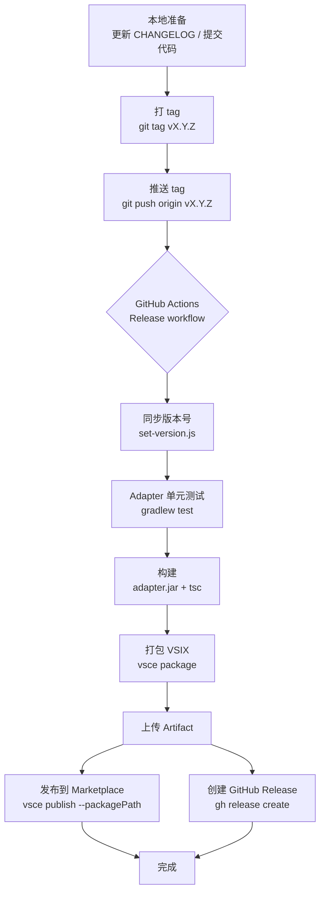
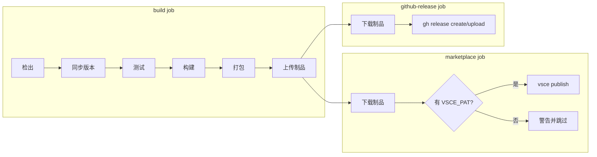

# 发布流程

本文档描述 `vscode-android-debugger` 的自动发布流程：以 git tag 为版本号唯一真相源，推送 tag 后由 GitHub Actions 自动构建、发布到 VS Code Marketplace，并创建 GitHub Release。

## 流程概览





## 前置配置

### 1. Marketplace publisher

扩展的 `publisher` 为 `6xyun`（见 `extension/package.json`）。首次发布前需要在 [Visual Studio Marketplace](https://marketplace.visualstudio.com/manage) 创建一个同名 publisher。

### 2. Azure DevOps PAT

1. 访问 <https://dev.azure.com> → 用户设置 → Personal Access Tokens
2. 选择 "All accessible organizations"（或对应的组织）
3. 勾选作用域 **Marketplace → Manage**
4. 生成并复制 token

### 3. 配置仓库 Secret

在 GitHub 仓库 **Settings → Secrets and variables → Actions → New repository secret** 中新增：

| Secret 名称 | 值 |
|-------------|-----|
| `VSCE_PAT`  | 上一步生成的 Azure DevOps PAT |

> 未配置 `VSCE_PAT` 时，Marketplace 步骤会被跳过并在日志中输出 `::warning::` 警告，GitHub Release 仍会正常创建。

## 日常发布

```bash
# 1. 确认工作区干净, 且 CI 已通过
git status
git log --oneline -3

# 2. 打 tag (仅接受 vX.Y.Z 三段式, Marketplace 不接受 1.2.3-beta.1 这类预发布版本号)
git tag v0.1.0

# 3. 推送 tag, 触发发布流水线
git push origin v0.1.0
```

推送后可在仓库 **Actions → Release** 查看流水线。

## 版本号同步规则

`scripts/set-version.js` 以 tag 为唯一真相源，把版本同步到以下位置：

| 文件 | 说明 |
|------|------|
| `extension/package.json` | Marketplace 实际发布的版本 |
| `extension/package-lock.json` | 与 package.json 保持一致 |
| `package.json` | monorepo 根包版本 |
| `adapter/build.gradle.kts` | adapter jar 的 manifest 版本 |

同步只在 CI 工作区中进行，**不会回写仓库**——仓库里的版本号以最后一次提交为准，tag 才是发布时的实际版本。因此若想让仓库版本号与已发布版本保持一致，需要手动执行：

```bash
node scripts/set-version.js v0.1.0
git commit -am "chore: bump version to 0.1.0"
```

`scripts/update-changelog.js` 负责在 `extension/CHANGELOG.md` 顶部插入新版本条目，按**版本号**判重（本地时区与 CI 的 UTC 日期可能相差一天，按日期判重会插入重复条目）。可本地执行：

```bash
node scripts/update-changelog.js 0.1.0 2026-11-02 "- 新增 xxx" "- 修复 yyy"
```

## 流水线阶段说明

### build job

| 步骤 | 说明 |
|------|------|
| 检出代码 | `fetch-depth: 0`，保留完整 git 历史 |
| 安装 JDK 21 | adapter 使用 JDK 21 版 JDI API |
| 安装 Node 20 | 扩展编译与 vsce 打包 |
| 同步版本号 | 以 tag 同步 package.json / package-lock.json / build.gradle.kts，并更新 CHANGELOG |
| 安装扩展依赖 | `npm ci`（`extension/`） |
| Adapter 单元测试 | `gradlew test` |
| 构建 | `npm run build` → adapter jar + TypeScript 编译 |
| 打包 VSIX | `vsce package --no-dependencies`（vsce 必须在 `extension/` 下执行，它从 cwd 读取 package.json） |
| 上传制品 | 上传 `dist/vscode-android-debugger-<version>.vsix` |

### marketplace job

- 使用 `vsce publish --packagePath`，直接发布已打包的 vsix，**不再触发 prepublish 全量构建**
- `--skip-duplicate` 保证重复运行幂等（版本已存在时静默跳过）

### github-release job

- 使用 runner 自带的 `gh` CLI，需要 `contents: write` 权限（workflow 已声明）
- Release 已存在时执行 `upload --clobber` + `edit` 覆盖，保证重跑安全

## 本地模拟发布

```bash
# 同步版本号
node scripts/set-version.js v0.1.0

# 构建
npm run build

# 打包 (vsce 会触发 prepublish, 即根目录 npm run build)
cd extension && npx vsce package --no-dependencies --out ../dist/test.vsix
```

> `extension/resources/*.jar` 被 `.gitignore` 排除，CI 中必须先构建才会打进 vsix。

## 常见问题

### Marketplace 发布报 "You must be authenticated to access VS Marketplace"

`VSCE_PAT` 未配置或已过期。检查 Secret 是否存在，并确认 PAT 的 Marketplace 作用域为 **Manage**。

### Marketplace 发布报版本已存在

该版本此前已发布。流水线已带 `--skip-duplicate`，会静默跳过；如需重新发布请提升版本号。

### vsce 报 "package.json not found" 或 publisher 缺失

`vsce` 必须以 `extension/` 为工作目录执行。仓库根 `package.json` 是 private monorepo 包，没有 publisher 字段。

### 构建失败在 gradle 步骤

adapter 需要 **JDK 21**。本地可用 `java -version` 确认；CI 已固定 `java-version: 21`。
